# VBGRAMG DEO Assistant & Worker Demand

**Prepare worker requests on Android. Check Work Demands and manage records on Windows or Linux.**

VBGRAMG DEO Assistant helps Data Entry Operators (DEOs) organise Job Cards, workers, work requests and Muster Roll reports. The companion **Worker Demand** Android app lets DEOs and Panchayat Secretaries prepare requests from their assigned areas.

Portal setup has two steps: **Select login area → Sign in**. A confirmed sign-in opens **Work Demand → Create demand**. Work-area selection and record downloads are separate tools.

The desktop downloads one area at a time. The Panchayat or Village in the active tab goes first. Changing area keeps saved progress, and other queued areas continue one by one afterward. Settings shows the download order and each area's status.

**Settings → Factory reset** deletes all local app records, downloads, settings, areas, drafts, local history, recovery copies and saved sign-ins for every app account on this computer. Read the confirmation, tick the warning and choose **Reset app and restart** to begin again at first setup. Cancel keeps your data. Online account records, balance, official portal records and files exported outside the app stay in place.

Changing area wakes downloads straight away. The next area starts after the previous read stops, without waiting for the regular background check. If records were deleted or downloads were paused, the message explains how to start again.

Downloads also follow the area opened in Browser. The order is **Job Card numbers → household and worker details → Aadhaar Authentication, Aadhaar Seeding, ABPS and eKYC → worked days and days left → other records → actual Aadhaar Availability confirmation**. Other areas wait, and saved progress is kept when you switch.

When all four worker checks are Yes, the worker shows **Aadhaar Availability: Yes** and you can prepare Work Demand straight away. The app remembers that this comes from the four checks. The separate Work Demand form is checked later; its actual Yes or No replaces the temporary answer. An actual No blocks that worker and shows the reason. Download counts include actual reads only.

Switching Panchayat or Village gives the new choice the next turn, including a place visited earlier. Required worker checks keep priority after its public lists finish. Area lists continue automatically while the previous page finishes.

The progress bar names the selected Panchayat or Village. A compact **Download overview** names the area currently downloading, its measured progress, and paused and queued areas. Longer lists open with **more**. The display updates automatically, and paused downloads resume after the priority area finishes. Deliberate pauses are kept.

The app avoids finding the same area and Job Cards again for every household. It still checks each worker. On the last household page, new answers, readable day figures and the download result save together. A failed save cannot leave a new completion result behind.

When the complete registration and issued-card lists agree, required worker checks can start before the remaining household detail pages. The Village stays unfinished until the final checks pass. Saved-record updates refresh the visible counts sooner and keep your selected area.

Day figures use the **125-day Job Card total**: calculate days left from days worked, or days worked from days left. A saved current total avoids a separate portal request. Job Cards, worker details and all four worker checks come first. Day figures follow, then Work Codes and reported Work Order numbers in one complete list shared across the Panchayat's Villages. The separate Aadhaar Availability confirmation comes last.

The selected Panchayat or Village downloads automatically, first and alone, and unfinished work retries on its own. **Recheck data** asks for fresh information for the selected Panchayat or Village and year. Confirmed **Aadhaar Availability: Yes** answers are kept for the same worker and Job Card, including during a recheck.

**Settings → Manage downloaded data** shows each area's download status, last saved date and record counts. Every Panchayat and Village has **Download**, **Recheck** and **Delete** buttons. Download continues missing records; Recheck asks for fresh information for the chosen year. Saved records are shared across the app. Use **Select All – Fully Downloaded**, **Partial**, **Interrupted/Incomplete**, **Queued**, or **Select All**, then adjust any ticks. Choose **Delete Selected** or **Remove from Queue** and confirm once. Queue removal keeps saved data. A missing Village list does not block Panchayat deletion.

**Delete Selected** pauses all downloads automatically, waits for the current page and its saved progress, then deletes the reviewed downloaded records after checking a private recovery copy. Downloads stay paused after reopening until you choose to start them again.

[Get the apps](#download) · [User guide](docs/USER_GUIDE.md) · [Features](docs/FEATURES.md) · [Latest changes](docs/LATEST_CHANGES.md)

The desktop shows download counts for the selected area, including after reopening. A stopped download explains the reason and offers **Download records again**. Completed records are reused.

Progress reads family records together to avoid repeated lookups. Worker-check counts follow the same matching rules as the worker reader. If a name or worker number changes, earlier answers stay saved and show that an update is needed.

| For the office | For the phone |
| --- | --- |
| **VBGRAMG DEO Assistant · Windows and Linux** | **Worker Demand · Android** |
| Find Job Cards, check workers and dates, review requests and prepare attendance reports. | Choose assigned workers, enter their requested days and send a request to the office. |
| Use your own office account and the portal's current area lists. | Use the private login code assigned by your DEO. |

## Download

Published downloads: desktop **1.4.28**, Android **1.4.28**.

| Device | Download |
| --- | --- |
| Windows 64-bit | [Download 1.4.28](https://github.com/Changtey/Worker-Demand-releases/releases/download/v1.4.28/VBGRAMG-DEO-Assistant-1.4.28-Setup.exe) |
| Linux Debian / Ubuntu | [Download 1.4.28](https://github.com/Changtey/Worker-Demand-releases/releases/download/v1.4.28/VBGRAMG-DEO-Assistant-1.4.28-Linux-x64.deb) |
| Linux AppImage | [Download 1.4.28](https://github.com/Changtey/Worker-Demand-releases/releases/download/v1.4.28/VBGRAMG-DEO-Assistant-1.4.28-Linux-x64.AppImage) |
| Android APK | [Download 1.4.28](https://github.com/Changtey/Worker-Demand-releases/releases/download/v1.4.28/Worker-Demand-1.4.28.apk) |

[Release notes and checksums](https://github.com/Changtey/Worker-Demand-releases/releases/tag/v1.4.28).

Check the linked release notes for tested systems and remaining limits. Windows publisher signing is still pending for the current test release.

## Watch and practise

The tutorial was refreshed on **3 November 2026**. Follow real app screens, slow spoken instructions and captions. All names, places and dates in the lesson are samples.

| Learn your way | Open |
| --- | --- |
| Tutorial: 9 short lessons, 6 minutes 21 seconds | [Watch the tutorial](https://changtey.github.io/Worker-Demand-releases/learn/classroom.html) |
| Guided practice with sample workers | [Try the practice app](https://changtey.github.io/Worker-Demand-releases/learn/practice.html) |
| Clear desktop and Android pictures | [Open full-size screenshots](https://changtey.github.io/Worker-Demand-releases/learn/screenshots.html) |
| Video file | [Open or download the tutorial](https://changtey.github.io/Worker-Demand-releases/videos/VBGRAMG-Tutorial-Simple-English.mp4) |

Watch a lesson, pause to read the screen, then try the steps. The practice copy ends at **Check demand**. It cannot send records to the office or the official work website.

The tutorial covers setup, area choices, Android requests, office review, days and dates, saved results, reports and settings. Read the result carefully: finishing entry steps is different from confirming that a demand was saved.

[Tutorial captions](https://changtey.github.io/Worker-Demand-releases/videos/VBGRAMG-Tutorial-Simple-English.srt) · [Written script](https://changtey.github.io/Worker-Demand-releases/videos/tutorial-transcript.txt) · [Lesson times](https://changtey.github.io/Worker-Demand-releases/videos/Tutorial-Simple-English-chapters.txt)

[Watch the earlier 60-second introduction](https://changtey.github.io/Worker-Demand-releases/#watch). Its 80–90% figure is the creator's estimate; actual results vary. The introduction uses CC0 public-domain music. The new tutorial has spoken instructions without music. The apps are free to download; some computer tasks use Balance. Read the current costs in the user guide.

## Follow your daily work

Open **Work Demand** at any time, including before portal sign-in. All app menus stay available during setup and downloads. Follow **Area → Workers → Work → Days and dates → Review and send → Result**. The last Create demand or Received requests choice is kept. Extra information opens when needed, and problems stay clear. Portal checks and entry still need the right signed-in account. Android uses **Send to office** for phone requests.

## What you can do

Work Demand can try temporary browser problems again before filling starts. **Try again** and **Continue remaining entries** keep earlier results. Any worker with an uncertain Proceed result stays held for checking in that run. In a later run, VBGRAMG's saved demands decide whether the worker is entered again.

On first use, sign in to VBGRAMG in **Browser** and save your assigned Panchayats or Villages. You can continue when essential worker details and checks are ready, before every download reaches 100%. Your default login page and work areas are kept for your account. Change areas later in Settings. Daily background updates continue, while matching completed eKYC, ABPS and confirmed Aadhaar Availability checks keep their original check dates.

- Find Job Cards, household members, saved worker checks and days left.
- Search by name or Job Card; filter by active status, Aadhaar availability, identity checks and Aadhaar payment checks.
- Prepare each worker's requested days and dates, then use **Check demand** to find issues.
- Days worked and days remaining are information only. Missing, old, zero or small saved totals do not block creating, approving or sending a request, or reduce the days you enter.
- See confirmed submission counts and named worker issues after desktop entry. Retry failed entries safely and reopen the saved completion summary later.
- Receive Received requests, prepare their area records automatically in the background, review changes and start entry in the desktop Browser.
- Give a DEO personal Android access or assign separate Secretary access.
- Reuse saved Panchayats and Villages from My Areas when creating your personal Android login code.
- On Android, check selected workers directly against public portal reports. See eKYC, active status, days worked and confirmed family days left, with each answer's source and check time.
- Prepare Muster Roll reports, save area choices and arrange your menus.
- Check your **Balance** and open **Recharge** when a task needs more. Your current work and report choices are kept.

The app follows the portal's offered **State → District → Block → Panchayat → Village** lists and Financial Years. It is designed for use across India. The example areas below do not limit where it can be used; checking these examples is not proof that every State has been tested.

## See the app

**Screens captured for desktop 1.4.28 and Android 1.4.28 · 2026-11-03.**

All 15 pictures use fictional records. **Android** pictures show the current Android screens at phone size. **Desktop preview** pictures show the current desktop app in a narrow window; they do not mean that desktop tools are available in Android. Open any picture for the full size. The pictures do not show a real office account or an official submission.

<table>
<tr>
<td width="33%" valign="top"><b>01. Your Android home</b> Android <a href="docs/screenshots/01-dashboard.png">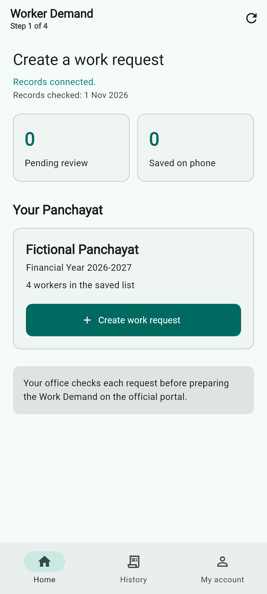</a> See assigned areas and start a work request.</td>
<td width="33%" valign="top"><b>02. Personal Android access</b> Desktop preview <a href="docs/screenshots/02-android-login.png">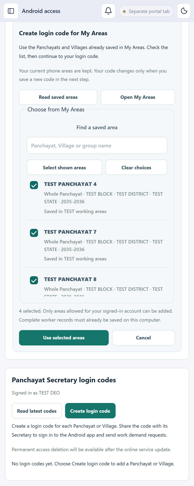</a> Review Panchayats and Villages already saved in My Areas, then continue to your personal Android login code. This narrow desktop preview uses fictional records.</td>
<td width="33%" valign="top"><b>03. Secretary access</b> Desktop preview <a href="docs/screenshots/03-secretary-access.png">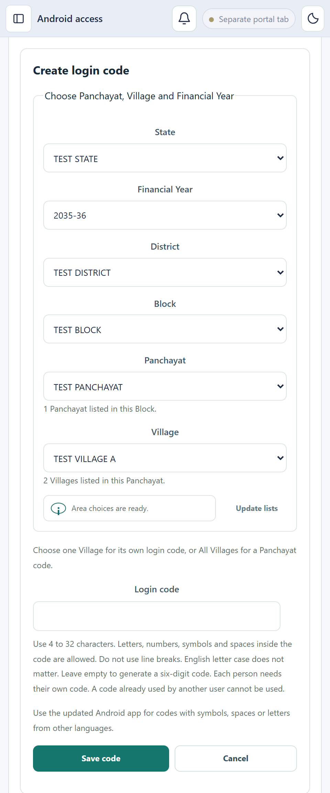</a> Assign a Panchayat or Village and create a Secretary login code.</td>
</tr>
<tr>
<td width="33%" valign="top"><b>04. First setup and your login page</b> Desktop preview <a href="docs/screenshots/04-integrated-browser.png">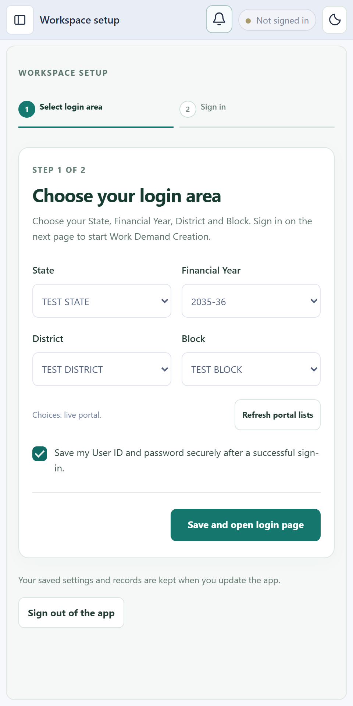</a> Two setup steps: Select login area and Sign in. Work Demand Creation opens after a confirmed portal sign-in. Setup does not ask for work areas or record downloads. This narrow desktop preview uses fictional choices; the official website is not pictured.</td>
<td width="33%" valign="top"><b>05. Review a phone request</b> Android <a href="docs/screenshots/05-android-work-demand.png">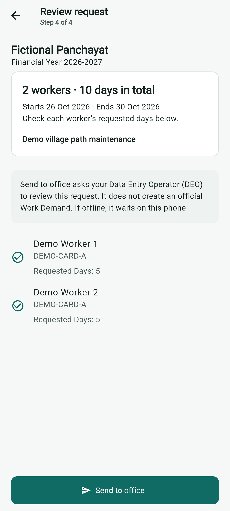</a> Review workers and their requested days, then use Send to office. This sends a phone request for DEO review; it does not create an official portal demand.</td>
<td width="33%" valign="top"><b>06. Secretary request history</b> Android <a href="docs/screenshots/06-secretary-work-demand.png">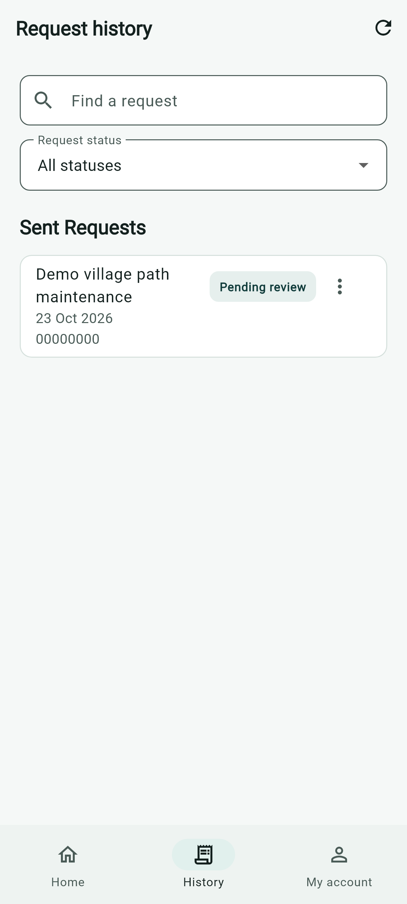</a> Find requests and follow the status returned by the office.</td>
</tr>
<tr>
<td width="33%" valign="top"><b>07. Job Card households</b> Desktop preview <a href="docs/screenshots/07-job-card-holders.png">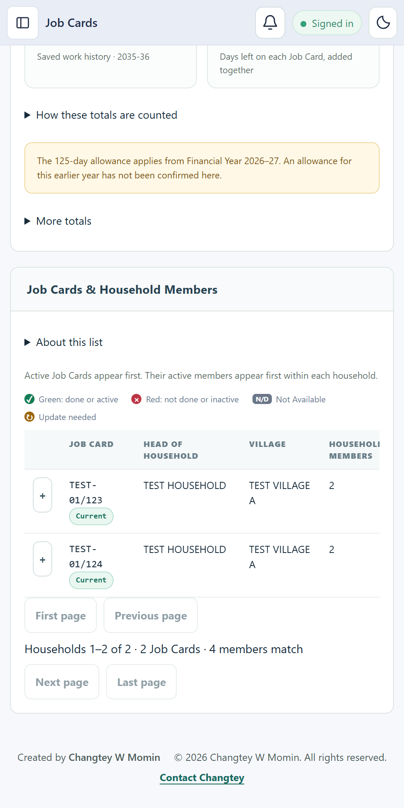</a> Find household heads and open the members of a Job Card. Swipe the table for more columns.</td>
<td width="33%" valign="top"><b>08. Choose workers and days</b> Android <a href="docs/screenshots/08-worker-list.png">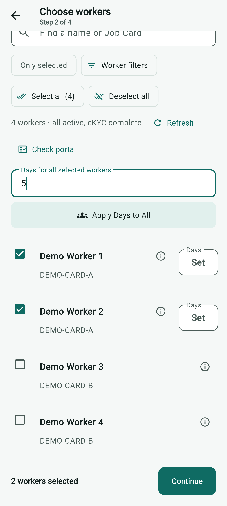</a> Choose workers and days. Check portal reads their public reports on the phone. Open a worker&#x27;s information button for answers, sources and check times.</td>
<td width="33%" valign="top"><b>09. Worker filters</b> Desktop preview <a href="docs/screenshots/09-worker-search.png">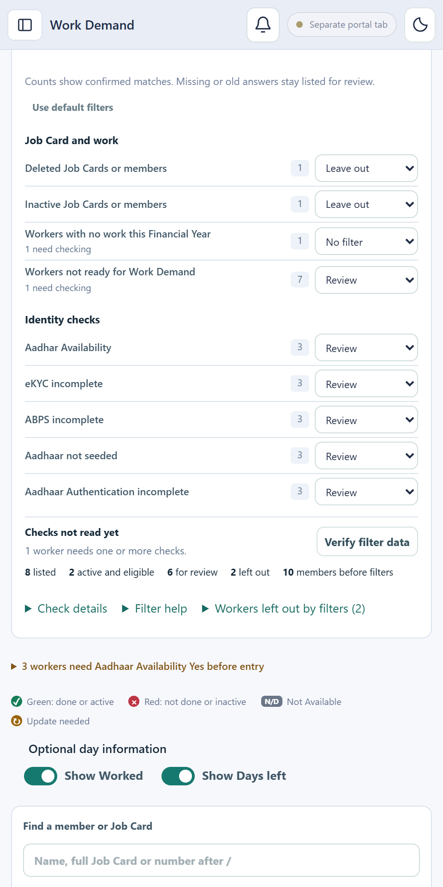</a> Keep the list compact with saved status and identity check choices.</td>
</tr>
<tr>
<td width="33%" valign="top"><b>10. Preview, save and print a demand</b> Desktop preview <a href="docs/screenshots/10-work-demand-entry.png">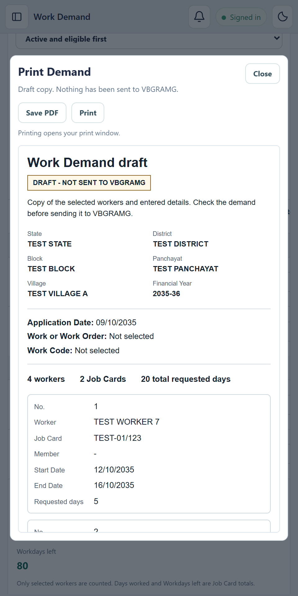</a> Review selected workers, full Job Cards, dates and totals before portal entry. Save PDF or Print a draft copy. Nothing is sent by making a copy. This is a narrow desktop preview with fictional records.</td>
<td width="33%" valign="top"><b>11. Check demand issues</b> Desktop preview <a href="docs/screenshots/11-check-demand.png">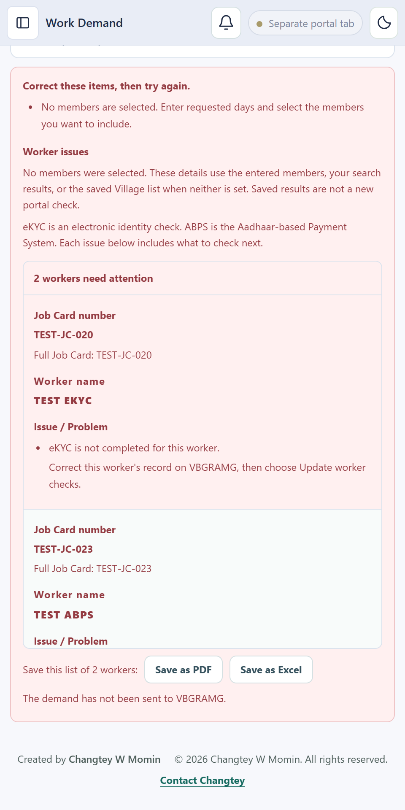</a> See the worker and the required check needing attention. eKYC and ABPS remain required; optional seeding and day figures do not block a demand.</td>
<td width="33%" valign="top"><b>12. Record download progress</b> Desktop preview <a href="docs/screenshots/12-worker-management.png">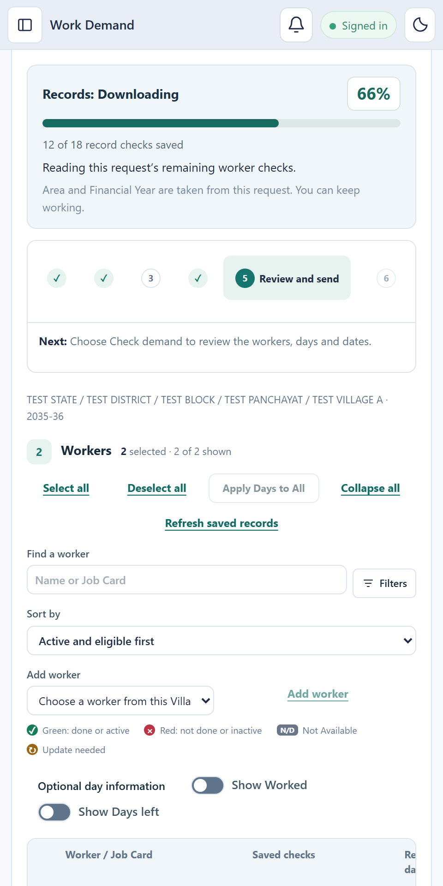</a> Follow the measured record download percentage on a received request. Saved checks set the percentage; record download progress does not mean a demand was submitted.</td>
</tr>
<tr>
<td width="33%" valign="top"><b>13. Muster Roll Reports</b> Desktop preview <a href="docs/screenshots/13-muster-reports.png">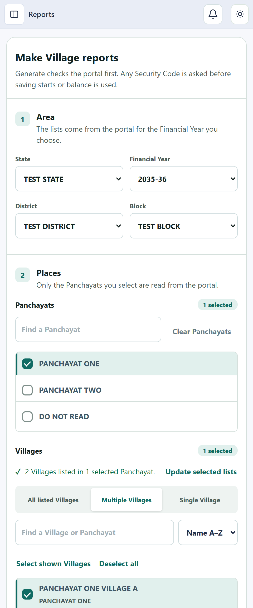</a> Choose Panchayats and Villages for the official attendance reports.</td>
<td width="33%" valign="top"><b>14. Manage downloaded data</b> Desktop preview <a href="docs/screenshots/14-settings.png">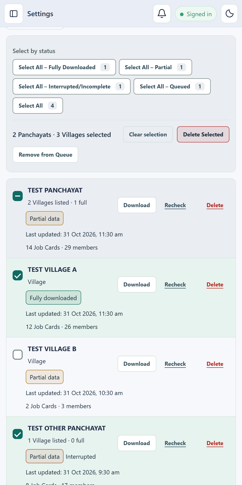</a> Download, recheck or delete from any row. Select by status for bulk actions. Saved records are shared across the app. Remove from Queue keeps saved data. This is a narrow desktop preview.</td>
<td width="33%" valign="top"><b>15. Your Android account</b> Android <a href="docs/screenshots/15-my-account.png">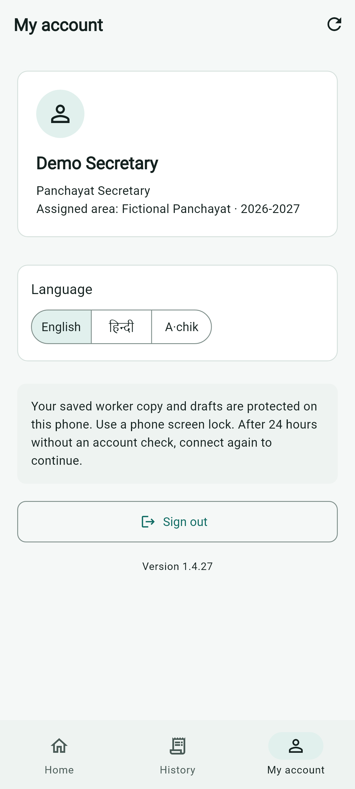</a> Check your role and assigned area, or sign out. Android follows the phone system colours.</td>
</tr>
</table>

## Start here

In **Work Demand**, use **Your work** to find unfinished requests and **Check problems** for the next useful action. **Settings → Records → Record backups** keeps checked local copies. See the preview or release status above to know which app files contain these features.

1. Install the matching desktop or Android download above.
2. On desktop, sign in with your Google account and choose your current area and Financial Year.
3. Use **Android access** for your personal Android access or a Secretary's assigned access. Share the code privately.
4. In Android, enter the assigned code, choose workers, enter days and dates, review, then choose **Send to office**. The request goes to the office.
5. In desktop, open **Work Demand**. Choose **Received requests** or **Create demand**. Check the workers and resolve the reported issues before the next portal action.

From Windows version 1.4.18, choose **Update now** once to download, check, install and reopen the updated app. Saved records and login details are kept. Install this version once to receive the improved updater; older installed versions still use their earlier update steps. Linux and Android keep their normal installation steps.

Active worker downloads use occasional portal-menu reads to help keep the connection active. Slow report pages get more time. If the portal requires sign-in again, your completed records are kept while you sign in personally.

Checked households appear as they are saved, while unfinished downloads stay clearly marked. Repeated area requests share work. Extra reports start after 15 seconds without activity and yield when you return. The Job Cards screen searches all saved households and keeps its current page during background updates. Missing worker checks never show **Eligible**.

You can start work after your selected areas' worker and workday records are checked. Muster Roll source reports continue in the background. The Notifications bell links to unfinished reports. Pending Aadhaar questions stay clearly marked and do not become approved answers.

### Try one request

**On Android:** Choose workers → enter the days → press **Apply Days to All** if everyone needs the same number → **Continue** → review → **Send to office**.

**In the office:** Open the received request → check the area, workers and dates → **Check demand** → correct any issues → review before **Send to VBGRAMG**.

**For attendance reports:** Open **Muster Roll Reports** on desktop → choose Panchayats and Villages → review the report choices → save the finished PDF or Excel file.

The [step-by-step guide](docs/USER_GUIDE.md) has short tutorials for the Browser, worker checks, Android access, requests, reports and settings.

## Know what has been saved

A phone draft stays on the phone. A submitted phone request goes to the DEO for review. **Check demand** checks details; it does not submit an official Work Demand. Starting portal entry is a separate action. The portal's **Proceed** can save an official demand. After entry, the app checks every selected worker's full Job Card, name, requested days and work dates in the saved portal list. **Work Demand completed and verified** appears only when every worker matches. An unfinished final check offers **Check saved list again**, which sends no new demand. A separate final **Submit**, where offered, stays under your control.

Use only areas and records you are authorised to access. Enter the portal Security Code yourself. Never share login codes, passwords or office records in public issues or screenshots.

## Current changes

**2 November 2026 — Balance held by unconfirmed Work Demand runs released**

Work Demand runs whose result was never confirmed no longer hold your Balance. All Balance they set aside is free again, and nobody was charged for them. The online service can now charge a run that stops part-way only for the workers whose demand was saved and checked, at 1 for every 20 of them. The app uses this from its next update. The change was checked online without starting a real run or making a payment. No installation file was replaced.

**2 November 2026 — Work Demand entry now costs half**

A successful Work Demand entry now uses 1 from your Balance for every 20 selected workers. A part of 20 counts as a full 20: 1–20 workers use 1, 21–40 use 2 and 100 use 5. Before, it was 1 for every 10 workers. ₹1 still adds 1 Balance, and Muster Roll Village reports still use 2 for each saved Village.

This online change applies to every app copy at once. Desktop 1.4.27 still says "every 10 workers" on its Balance page until the next app update, but it is charged the new, lower price. A run that already set aside Balance keeps its earlier price. The change was checked online without starting a run or making a payment. No installation file was replaced.

**30 October 2026 — Saved day totals are information only**

The online family day-total limit has been removed. Days worked and days remaining must not stop a Work Demand or reduce the requested days. Checks with fictional records confirmed approval and entry preparation, unchanged requested days and protection against repeated worker periods. Every fictional online test change was rolled back. The official portal was not contacted.

The separate desktop 1.4.23 correction also removes the old local approval check. The Android correction keeps requested days above earlier saved totals. These installation files are prepared and checked; installation and public app publication remain separate steps. Existing worker identity, required answers, dates and official portal checks remain in place.

**27 October 2026 — Remove your own assigned areas enabled online**

On desktop, open **Android access → My areas → Change my Android access**. Select your assigned Panchayats or Villages, choose **Remove selected areas**, check the names and choose **Remove areas**. You can remove only your own assignments. Other users' areas are protected. Saved worker records, requests, completed Work Demands, Muster Rolls, Secretary accounts, login codes and history are kept.

The missing online step is now enabled. Checks used temporary fictional areas in the online database and undid every test change. The current signed-in connection was also checked with an empty selection. No real areas were removed during these checks. This service update works with the existing removal screen; no new installation is needed.

**26 October 2026 — Balance charging enabled online**

Work Demand charging was turned on after the app publication. Browser automation now needs 1 available Balance before entry starts. It reserves that amount and deducts it after the saved Work Demand is confirmed. Zero available Balance blocks new runs and unfunded retries, including older unfinished free requests. Recharge opens with the current work kept. Failed runs release their reservation. Repeated starts and completion replies do not charge twice. Completed free work keeps its original price.

This online service update applies to the existing app downloads. The recharge package stays ₹50 for 50 Balance. No installation file was replaced. The earlier release notes describe the charging setting at the time they were written.

**Published 1.4.28**

- **Work Allocation check fixed.** Since 31 October the final check stopped on any unusual row in the Panchayat&#x27;s Work Allocation list, such as a blank footer row or another person&#x27;s row, so no entered worker was confirmed. Now an unclear row holds back only the worker it may belong to. Every other worker is still…
- **Large lists are entered in planned parts.** The portal takes new Work Demands only while fewer than 100 people in a Panchayat are waiting for Work Allocation. Before entry starts, the app counts the people already waiting (read-only) and plans the parts. After each part it stops, you allocate work on the portal,…
- **You are told when Balance is used.** Each Work Demand charge shows a **Balance used for Work Demand** notice in the bell: how much was used, for how many saved and checked workers, the area, any part owed and the Balance left. A new one also shows as a Windows notification. **Mark as read** removes it.
- **Work Demand price: 1 Balance for every 20 workers** (21–40 workers use 2; 100 workers use 5). A run that stops part-way pays only for the workers whose demand was saved and checked, and the rest of the set-aside Balance is released. These rules are on the online service already; this update shows them correctly…
- **Update now shows the installation.** The app downloads and checks the update, closes, and a small installer window shows the progress. The updated app then opens by itself. Before, nothing showed for about 40 seconds, so it looked as if the update had failed.
- **Muster Roll Reports.** Generate opens the portal report page first, so any Security Code is answered before anything is saved or Balance is held. You still type the code yourself. Report pages load faster, a page that does not open is tried twice more, and one failed Muster Roll no longer stops its Panchayat. The…

See [latest changes and their release status](docs/LATEST_CHANGES.md). The public repository holds downloads and guides. App building files and office records stay on the owner's computer.
