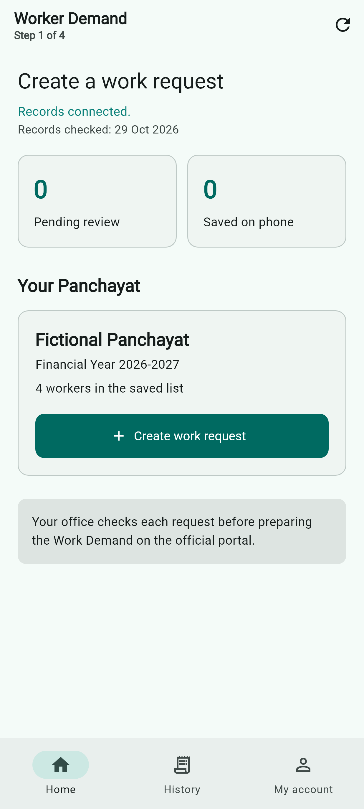
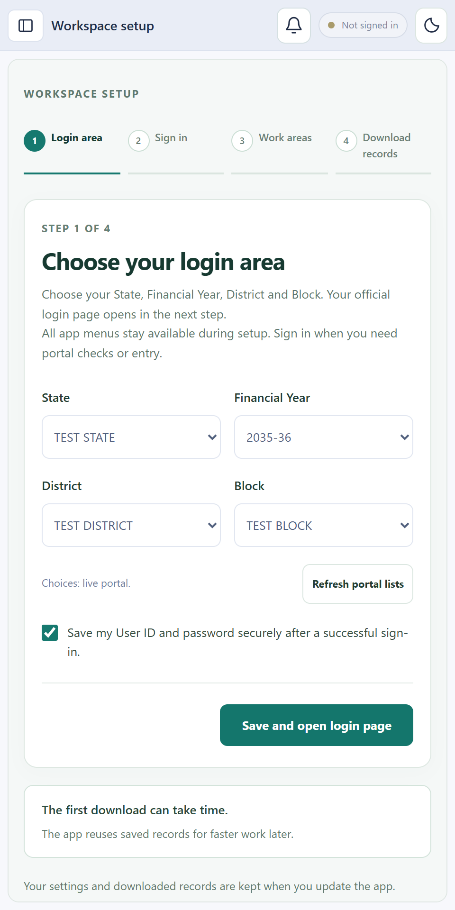
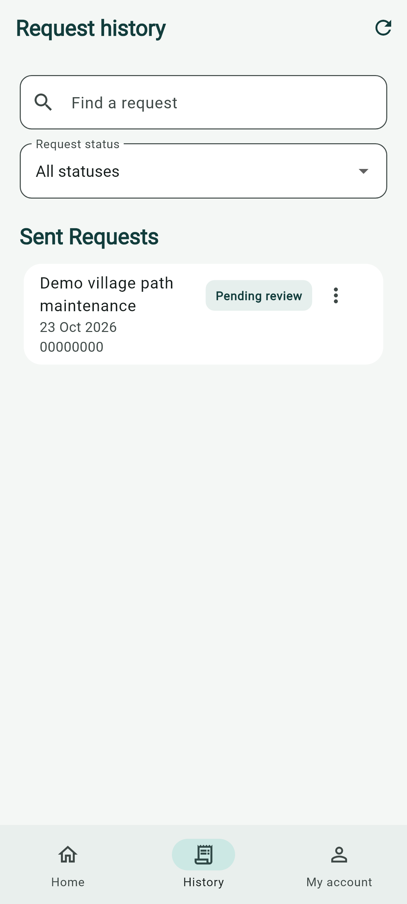
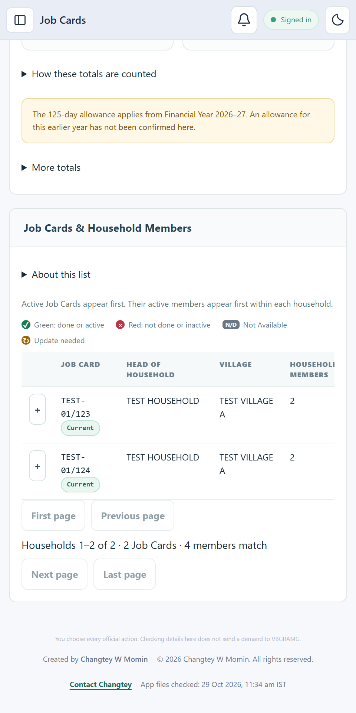
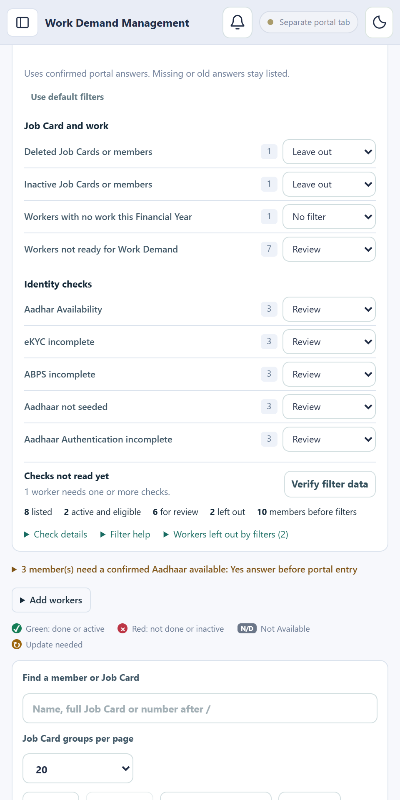
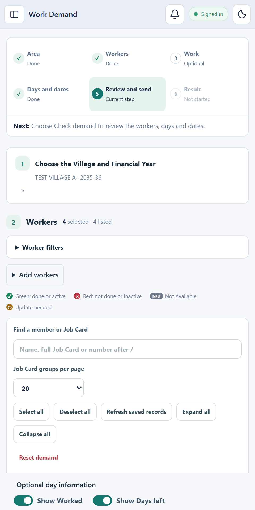
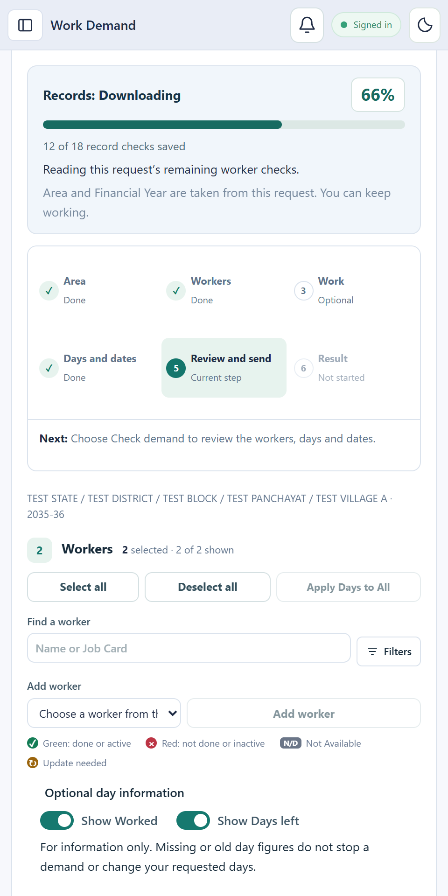
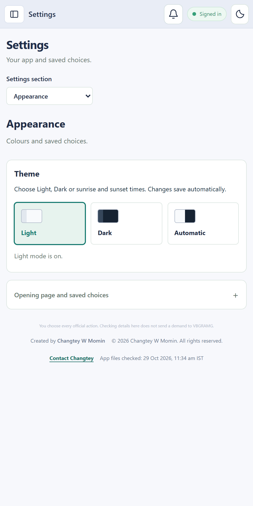
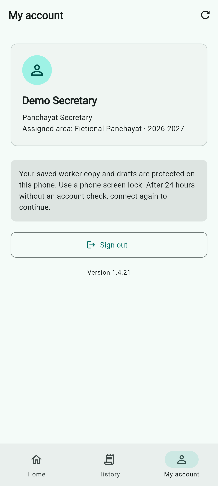

# VBGRAMG DEO Assistant & Worker Demand

**Prepare worker requests on Android. Check Work Demands and manage records on Windows or Linux.**

VBGRAMG DEO Assistant helps Data Entry Operators (DEOs) organise Job Cards, workers, work requests and Muster Roll reports. The companion **Worker Demand** Android app lets DEOs and Panchayat Secretaries prepare requests from their assigned areas.

[Get the apps](#download) · [User guide](docs/USER_GUIDE.md) · [Features](docs/FEATURES.md) · [Latest changes](docs/LATEST_CHANGES.md)

| For the office | For the phone |
| --- | --- |
| **VBGRAMG DEO Assistant · Windows and Linux** | **Worker Demand · Android** |
| Find Job Cards, check workers and dates, review requests and prepare attendance reports. | Choose assigned workers, enter their requested days and send a request to the office. |
| Use your own office account and the portal's current area lists. | Use the private login code assigned by your DEO. |

## Download

Published downloads: desktop **1.4.21**, Android **1.4.21**.

| Device | Download |
| --- | --- |
| Windows 64-bit | [Download 1.4.21](https://github.com/Changtey/Worker-Demand-releases/releases/download/v1.4.21/VBGRAMG-DEO-Assistant-1.4.21-Setup.exe) |
| Linux Debian / Ubuntu | [Download 1.4.21](https://github.com/Changtey/Worker-Demand-releases/releases/download/v1.4.21/VBGRAMG-DEO-Assistant-1.4.21-Linux-x64.deb) |
| Linux AppImage | [Download 1.4.21](https://github.com/Changtey/Worker-Demand-releases/releases/download/v1.4.21/VBGRAMG-DEO-Assistant-1.4.21-Linux-x64.AppImage) |
| Android APK | [Download 1.4.21](https://github.com/Changtey/Worker-Demand-releases/releases/download/v1.4.21/Worker-Demand-1.4.21.apk) |

[Release notes and checksums](https://github.com/Changtey/Worker-Demand-releases/releases/tag/v1.4.21).

Check the linked release notes for tested systems and remaining limits. Windows publisher signing is still pending for the current test release.

## Watch the videos

Videos for **version 1.4.15**, using fictional app examples.

| Video | Length | Watch or download |
| --- | --- | --- |
| Promo | 60 seconds | [Play the promo](https://github.com/Changtey/Worker-Demand-releases/releases/download/v1.4.16/VBGRAMG-Promo-60s.mp4) |
| Simple English tutorial | 7 minutes 30 seconds | [Play the tutorial](https://github.com/Changtey/Worker-Demand-releases/releases/download/v1.4.16/VBGRAMG-Tutorial-Simple-English.mp4) |

[Watch both videos on the download page](https://changtey.github.io/Worker-Demand-releases/#watch). The tutorial has 15 numbered steps, separate phone and computer sections, captions and buttons to repeat a lesson. It was refreshed on 26 October 2026.

The tutorial covers Received requests, desktop review, days worked, shared Job Card days left, electronic identity verification (eKYC), the Aadhaar Based Payment System (ABPS) and Aadhaar availability. Saved answers are separate from a new portal check. The promo's 80–90% figure is the creator's estimate; actual results vary.

[Promo captions](https://github.com/Changtey/Worker-Demand-releases/releases/download/v1.4.16/VBGRAMG-Promo.srt) · [Tutorial captions](https://github.com/Changtey/Worker-Demand-releases/releases/download/v1.4.16/VBGRAMG-Tutorial-Simple-English.srt) · [Tutorial chapters](https://github.com/Changtey/Worker-Demand-releases/releases/download/v1.4.16/Tutorial-Simple-English-chapters.txt)

Both videos use CC0 public-domain music. [Read the music-use details](https://github.com/Changtey/Worker-Demand-releases/releases/download/v1.4.16/Music-use.txt). The apps are free to download. Some computer tasks use Balance; read the current costs in the user guide.

## Follow your daily work

Open **Work Demand** at any time, including before portal sign-in. All app menus stay available during setup and downloads. Follow **Area → Workers → Work → Days and dates → Review and send → Result**. The last Create demand or Received requests choice is kept. Extra information opens when needed, and problems stay clear. Portal checks and entry still need the right signed-in account. Android uses **Send to office** for phone requests.

## What you can do

On first use, sign in to VBGRAMG in **Browser**, save your assigned Panchayats or Villages, and wait for the required downloads to reach **100%**. Your default login page and work areas are kept for your account. Change areas later in Settings. Daily background updates continue, while matching completed eKYC, ABPS and Aadhaar Availability checks are reused with their original check dates.

- Find Job Cards, household members, saved worker checks and days left.
- Search by name or Job Card; filter by active status, Aadhaar availability, identity checks and Aadhaar payment checks.
- Prepare each worker's requested days and dates, then use **Check demand** to find issues.
- See confirmed submission counts and named worker issues after desktop entry. Retry failed entries safely and reopen the saved completion summary later.
- Receive Received requests, prepare their area records automatically in the background, review changes and start entry in the desktop Browser.
- Give a DEO personal Android access or assign separate Secretary access.
- Reuse saved Panchayats and Villages from My Areas when creating your personal Android login code.
- On Android, check selected workers directly against public portal reports. See eKYC, active status, days worked and confirmed family days left, with each answer's source and check time.
- Prepare Muster Roll reports, save area choices and arrange your menus.
- Check your **Balance** and open **Recharge** when a task needs more. Your current work and report choices are kept.

The app follows the portal's offered **State → District → Block → Panchayat → Village** lists and Financial Years. It is designed for use across India. The example areas below do not limit where it can be used; checking these examples is not proof that every State has been tested.

## See the app

**Screens captured for desktop 1.4.21 and Android 1.4.21 · 2026-10-29.**

All 15 pictures use fictional records. **Android** pictures show the current Android screens at phone size. **Desktop preview** pictures show the current desktop app in a narrow window; they do not mean that desktop tools are available in Android. Open any picture for the full size. The pictures do not show a real office account or an official submission.

<table>
<tr>
<td width="33%" valign="top"><b>01. Your Android home</b> Android  See assigned areas and start a work request.</td>
<td width="33%" valign="top"><b>02. Personal Android access</b> Desktop preview  Review Panchayats and Villages already saved in My Areas, then continue to your personal Android login code. This narrow desktop preview uses fictional records.</td>
<td width="33%" valign="top"><b>03. Secretary access</b> Desktop preview  Assign a Panchayat or Village and create a Secretary login code.</td>
</tr>
<tr>
<td width="33%" valign="top"><b>04. First setup and your login page</b> Desktop preview  One guided page at a time: Login area, Sign in, Work areas and Download records. All app menus remain available before portal sign-in and during setup. Saved settings and records stay through updates. This narrow desktop preview uses fictional choices; the official website is not pictured.</td>
<td width="33%" valign="top"><b>05. Review a phone request</b> Android  Review workers and their requested days, then use Send to office. This sends a phone request for DEO review; it does not create an official portal demand.</td>
<td width="33%" valign="top"><b>06. Secretary request history</b> Android  Find requests and follow the status returned by the office.</td>
</tr>
<tr>
<td width="33%" valign="top"><b>07. Job Card households</b> Desktop preview  Find household heads and open the members of a Job Card. Swipe the table for more columns.</td>
<td width="33%" valign="top"><b>08. Choose workers and days</b> Android  Choose workers and days. Check portal reads their public reports on the phone. Open a worker&#x27;s information button for answers, sources and check times.</td>
<td width="33%" valign="top"><b>09. Worker filters</b> Desktop preview  Keep the list compact with saved status and identity check choices.</td>
</tr>
<tr>
<td width="33%" valign="top"><b>10. Guided Work Demand</b> Desktop preview  Follow the Work Demand steps. Show or hide Worked and Days left separately with saved switches. These figures are information only; your entered days stay unchanged.</td>
<td width="33%" valign="top"><b>11. Check demand issues</b> Desktop preview  See the worker and the required check needing attention. eKYC and ABPS remain required; optional seeding and day figures do not block a demand.</td>
<td width="33%" valign="top"><b>12. Record download progress</b> Desktop preview  Follow the measured record download percentage on a received request. Saved checks set the percentage; record download progress does not mean a demand was submitted.</td>
</tr>
<tr>
<td width="33%" valign="top"><b>13. Muster Roll Reports</b> Desktop preview  Choose Panchayats and Villages for the official attendance reports.</td>
<td width="33%" valign="top"><b>14. Simple app settings</b> Desktop preview  Choose a Settings section, then change the options you need. Work, App and Account choices stay together. This is a narrow desktop preview.</td>
<td width="33%" valign="top"><b>15. Your Android account</b> Android  Check your role and assigned area, or sign out. Android follows the phone system colours.</td>
</tr>
</table>

## Start here

In **Work Demand**, use **Your work** to find unfinished requests and **Check problems** for the next useful action. **Settings → Records → Record backups** keeps checked local copies. See the preview or release status above to know which app files contain these features.

1. Install the matching desktop or Android download above.
2. On desktop, sign in with your Google account and choose your current area and Financial Year.
3. Use **Android access** for your personal Android access or a Secretary's assigned access. Share the code privately.
4. In Android, enter the assigned code, choose workers, enter days and dates, review, then choose **Send to office**. The request goes to the office.
5. In desktop, open **Work Demand**. Choose **Received requests** or **Create demand**. Check the workers and resolve the reported issues before the next portal action.

From Windows version 1.4.18, choose **Update now** once to download, check, install and reopen the updated app. Saved records and login details are kept. Install this version once to receive the improved updater; older installed versions still use their earlier update steps. Linux and Android keep their normal installation steps.

Active worker downloads use occasional portal-menu reads to help keep the connection active. Slow report pages get more time. If the portal requires sign-in again, your completed records are kept while you sign in personally.

Checked households appear as they are saved, while unfinished downloads stay clearly marked. Repeated area requests share work. Extra reports start after 15 seconds without activity and yield when you return. The Job Cards screen searches all saved households and keeps its current page during background updates. Missing worker checks never show **Eligible**.

You can start work after your selected areas' worker and workday records are checked. Muster Roll source reports continue in the background. The Notifications bell links to unfinished reports. Pending Aadhaar questions stay clearly marked and do not become approved answers.

### Try one request

**On Android:** Choose workers → enter the days → press **Apply Days to All** if everyone needs the same number → **Continue** → review → **Send to office**.

**In the office:** Open the received request → check the area, workers and dates → **Check demand** → correct any issues → review before **Send to VBGRAMG**.

**For attendance reports:** Open **Muster Roll Reports** on desktop → choose Panchayats and Villages → review the report choices → save the finished PDF or Excel file.

The [step-by-step guide](docs/USER_GUIDE.md) has short tutorials for the Browser, worker checks, Android access, requests, reports and settings.

## Know what has been saved

A phone draft stays on the phone. A submitted phone request goes to the DEO for review. **Check demand** checks details; it does not submit an official Work Demand. Starting portal entry is a separate action. The portal's **Proceed** can save an official demand. After entry, the app checks every selected worker's full Job Card, name, requested days and work dates in the saved portal list. **Work Demand completed and verified** appears only when every worker matches. An unfinished final check offers **Check saved list again**, which sends no new demand. A separate final **Submit**, where offered, stays under your control.

Use only areas and records you are authorised to access. Enter the portal Security Code yourself. Never share login codes, passwords or office records in public issues or screenshots.

## Current changes

**27 October 2026 — Remove your own assigned areas enabled online**

On desktop, open **Android access → My areas → Change my Android access**. Select your assigned Panchayats or Villages, choose **Remove selected areas**, check the names and choose **Remove areas**. You can remove only your own assignments. Other users' areas are protected. Saved worker records, requests, completed Work Demands, Muster Rolls, Secretary accounts, login codes and history are kept.

The missing online step is now enabled. Checks used temporary fictional areas in the online database and undid every test change. The current signed-in connection was also checked with an empty selection. No real areas were removed during these checks. This service update works with the existing removal screen; no new installation is needed.

**26 October 2026 — Balance charging enabled online**

Work Demand charging was turned on after the app publication. Browser automation now needs 1 available Balance before entry starts. It reserves that amount and deducts it after the saved Work Demand is confirmed. Zero available Balance blocks new runs and unfunded retries, including older unfinished free requests. Recharge opens with the current work kept. Failed runs release their reservation. Repeated starts and completion replies do not charge twice. Completed free work keeps its original price.

This online service update applies to the existing app downloads. The recharge package stays ₹50 for 50 Balance. No installation file was replaced. The earlier release notes describe the charging setting at the time they were written.

**Published 1.4.21**

- Required worker records come first. The app reads worker identities, eKYC, ABPS and Aadhaar Availability before extra reports. A work report needed for the current demand keeps its required checks.
- Download requests for the same account, selected area, Financial Year and records share work. The selected Village goes first, followed by its siblings; the selected Panchayat stays ahead of other Panchayats.
- Checked households are saved in small batches and can appear before the whole Village finishes. Pauses, failures and restarts keep completed records. An unfinished download stays incomplete.
- Public readers reuse already checked Job Card details and area choices. Extra reports wait until the app has been idle for at least 15 seconds and yield when activity resumes. Deliberate pauses and portal entry protection remain in place.
- Job Card lists and totals load together. Search covers the full saved list before choosing the display page. Background updates keep search, open households, selected workers, entered days and dates.
- Required worker checks remain mandatory. Missing answers never mean eligible. Days worked and days left remain information and do not change entered days. Work selection stays optional; a chosen work keeps its checks.

See [latest changes and their release status](docs/LATEST_CHANGES.md). The public repository holds downloads and guides. App building files and office records stay on the owner's computer.
