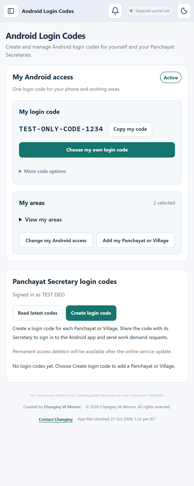
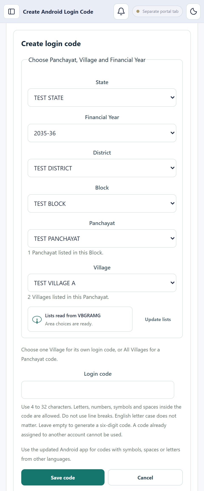
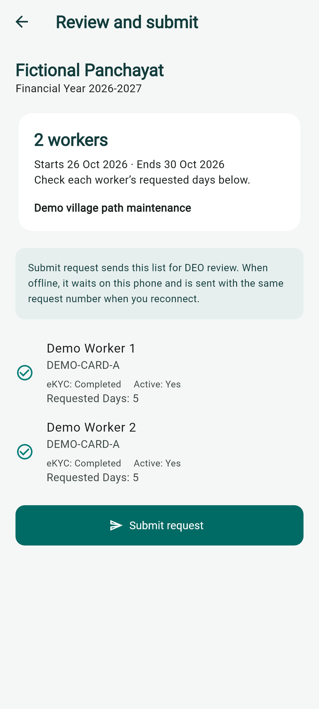
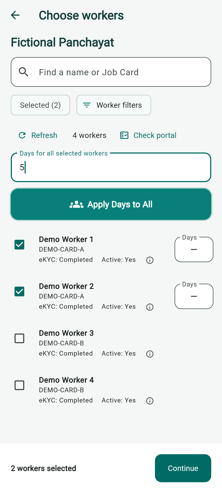
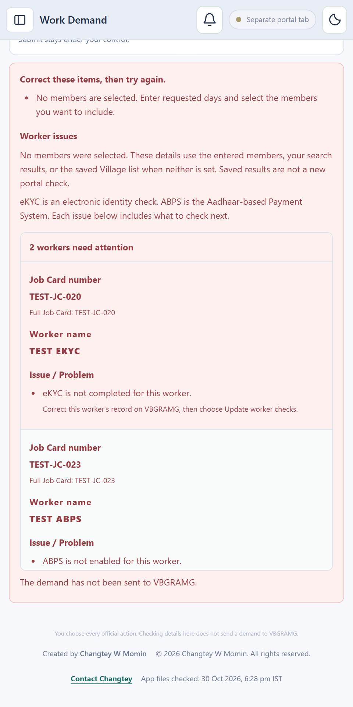
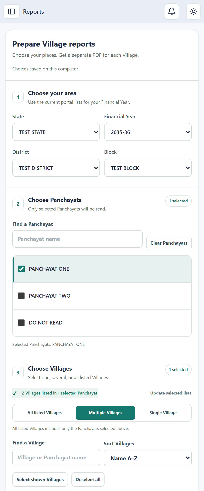

# User guide

[Home](../README.md) · [Feature list](FEATURES.md) · [Latest changes](LATEST_CHANGES.md)

**Screens captured for desktop 1.4.24 and Android 1.4.24 · 2026-10-30.**

Screenshots use fictional people and areas. Android and desktop are labelled separately. Your assigned areas and the portal's current lists determine what you can see.

## Watch the videos

Videos for **version 1.4.15**, using fictional app examples.

| Video | Length | Watch or download |
| --- | --- | --- |
| Promo | 60 seconds | [Play the promo](https://github.com/Changtey/Worker-Demand-releases/releases/download/v1.4.16/VBGRAMG-Promo-60s.mp4) |
| Simple English tutorial | 7 minutes 30 seconds | [Play the tutorial](https://github.com/Changtey/Worker-Demand-releases/releases/download/v1.4.16/VBGRAMG-Tutorial-Simple-English.mp4) |

[Watch both videos on the download page](https://changtey.github.io/Worker-Demand-releases/#watch). The tutorial has 15 numbered steps, separate phone and computer sections, captions and buttons to repeat a lesson. It was refreshed on 26 October 2026.

The tutorial covers Received requests, desktop review, days worked, shared Job Card days left, electronic identity verification (eKYC), the Aadhaar Based Payment System (ABPS) and Aadhaar availability. Saved answers are separate from a new portal check. The promo's 80–90% figure is the creator's estimate; actual results vary.

[Promo captions](https://github.com/Changtey/Worker-Demand-releases/releases/download/v1.4.16/VBGRAMG-Promo.srt) · [Tutorial captions](https://github.com/Changtey/Worker-Demand-releases/releases/download/v1.4.16/VBGRAMG-Tutorial-Simple-English.srt) · [Tutorial chapters](https://github.com/Changtey/Worker-Demand-releases/releases/download/v1.4.16/Tutorial-Simple-English-chapters.txt)

Both videos use CC0 public-domain music. [Read the music-use details](https://github.com/Changtey/Worker-Demand-releases/releases/download/v1.4.16/Music-use.txt). The apps are free to download. Some computer tasks use Balance; read the current costs below.

## 1. Install and sign in

### First setup for your app account

All app menus stay available before portal sign-in and while setup or downloads are unfinished. You can open Work Demand, Reports, Job Cards, My Areas, Android access and Settings at any time. Return to **Browser** to finish setup or sign in. Opening a menu does not sign you in or submit records. Portal checks and entry still need the right signed-in account and the required worker checks.

**The app may be slow at first. Saved records make later work faster.** The first download reads and checks the records for your chosen areas. As you use the same areas, the app reuses saved records, so later work is usually faster. New areas and slow portal pages can still take time. Keep the app open while the progress bar moves.

Days worked and Aadhaar Availability can come from the same Job Card page. Their checked counts may move at different times. The progress message names the check being read and shows the Job Card count for that area. Missing Aadhaar answers go before daily days-worked reads within the same area. A complete first member page is read once; any further pages must still finish. Use **Retry missing data** for unfinished records. In Settings, **Download Data** reuses current saved records; **Update Data** asks for new checks. An empty payment or attendance report does not prove zero days worked.

During active signed-in worker downloads, the app occasionally reads the portal menu to help keep the connection active. It does not reload your working form. Slow report pages get more time to finish. If the portal asks you to sign in again, complete that check yourself. Earlier downloaded records are kept, and unfinished reads can continue after sign-in. A separate Muster Roll Security Code still needs your own answer.

1. Sign in to the app with your own Google account. **First setup** opens on the first visit. After setup, **Work Demand** opens first.
2. On the **Login area** page, choose your State, Financial Year, District and Block from the current portal lists. Choose **Save and open login page**. Setup shows one page at a time. The official portal gets the full workspace during sign-in. The app keeps these choices in **Settings → Portal login**, separately for each app account on this computer. Use **Change login area** when needed.
3. In **Sign in**, enter your User ID, password and CAPTCHA (Security Code) on the official VBGRAMG page, then choose Login yourself. **Save my User ID and password securely after a successful sign-in** is selected on the Login area form. Clear that choice if you do not want to save them. Only a confirmed sign-in saves the original pair in the computer's secure storage. A failed login keeps the earlier saved pair. The CAPTCHA is never saved. Browser **Save login details**, **Update login details** and **Login details** remain available.
4. Select only the Panchayats or Villages assigned to you for data entry. A whole Panchayat includes its Villages. Choose **Save areas and continue**. These are your work choices; saving them does not grant government portal access.
5. On **Download records**, tick the record types you want now, then choose **Download selected records**. You can choose Job Cards, workers and work records; days worked and shared Job Card family days left; eKYC; Aadhaar seeding; Aadhaar authentication; ABPS; Aadhaar Availability; and Muster Roll source reports. Use **Download later** or clear a tick to skip an item. Job Cards and workers must be saved before their other checks can finish. Some answers share one portal page and may be saved together.
6. Open **Worker download details** to see the report area and new pages read. The Panchayat or Village you are currently working on gets the first turn, even outside your setup areas. Use **Open report window** when a Muster Roll page needs a check. After every member is read, setup, Settings and the selected area show **Aadhaar Availability download completed**. The message gives separate counts for **Yes**, **No**, and **No answer selected on the portal**. No and unselected answers count as downloaded. Those members need a confirmed **Yes** on the portal before Work Demand; other eligible members can continue. Routine background rechecks do not undo a successful download. Unread, old or unclear records still need checking.
7. Choose **Continue to Work Demand** when the required worker records are saved, even if optional reports are unfinished. Each selected worker must still pass the required checks before a demand can be checked. You can also choose **Skip remaining and continue** to open the app sooner. Completed downloads stay saved. Deferred items say **Waiting for idle** after you continue, with saved checked counts kept visible. Remaining records, including Muster Roll source reports, download in the background when the app is idle. Missing records remain unchecked. Setup and your download choices are saved for your app account.

If the percentage stops changing, open **Reports that need attention**. The list names the Villages and checks that are still missing. After a worker read, it explains whether a Yes or No answer could not be read, worker details did not match, a Job Card was missing from the portal list, or a member list did not load. Keep the app open and signed in while retrying. An unavailable answer stays unknown; a retry cannot invent it. If a Muster Roll summary total disagrees with its list, the app still saves reports that pass their own checks. Both totals remain visible. The affected report stays unfinished until it is checked; other work can continue.

Return to **Settings → Portal login → Manage record downloads** to see downloaded and skipped items. Choose **Download now** beside a skipped item. Other skipped items stay skipped, including after reopening the app or using **Retry missing data**. Use **Change my work areas** to add or remove areas while keeping at least one working area. Choose the downloads for a changed area before starting them. Existing saved records are kept.

Keep the desktop app open and connected. After you continue, records set to **Download later** are picked up automatically when the app and computer have been idle for at least 15 seconds. The app checks idle time regularly, so the start may take a little longer. Your current area keeps priority. Worker reads wait while you enter portal records, and a deliberate pause is kept. Personal sign-in and report Security Codes still need your answer. A page already being read may finish when you resume work. Complete saved records are reused; missing and changed records are checked again. Completed eKYC, ABPS and Aadhaar Availability answers must match the same worker and Job Card. A deliberate **Update worker checks** can request a new read. Reusing an answer keeps its original check date; it is not a new live check.

Source-report downloads do not submit a Work Demand or generate a paid PDF copy. PDF saving and printing keep their existing separate confirmation and Balance rules.

### Update the Windows app

Choose **Update now** once. The app downloads and checks the file, closes for installation, and opens the updated app when installation finishes. Your settings, selected areas, downloaded records, drafts and securely saved login details are kept. A normal update does not repeat completed first setup or download everything again. Reports that need a daily update are checked as usual. If Windows asks for permission, read the request and allow your app's installer to continue. Do not turn off Windows protection.

If the download or installer cannot start, choose **Try again** in the same visit. The app reuses a downloaded file only after checking it again. **Open current app** remains available for an optional update. A required update must finish before the old app can be used.

**For older installed versions:** Install version 1.4.18 once to receive this improved updater. An older app still controls its own update steps until it is replaced. Linux and Android keep their normal device installation steps.

### Daily use

1. Open the [app downloads](https://github.com/Changtey/Worker-Demand-releases#download). Choose Windows, Linux or Android for your device.
2. Keep your existing app and saved records when updating. See the release notes for installation checks and known limits.
3. On desktop, use **Sign in with Google** and finish in your computer's usual browser. This is separate from your official portal login.
4. In **Settings → Portal login**, choose your State, Financial Year, District and Block from the current lists. Save the area.
5. Use **Show menu** on a narrow screen to open the app's menus. If an optional menu is hidden, show it in **Settings → Sidebar menus**.

The sidebar shows a short explanation under each tool. **Work Demand** brings Received requests and manual entry together. Use its two source choices to switch without losing your current draft. **Android access** opens your own and Secretary access tools. Choose **Arrange menus** to show, hide or group menus. You can also drag menus into your preferred order. **Collapse menu** keeps just the icons; **Expand menu** restores the names. Help and account links stay at the bottom.

Your selected Panchayat and Village stay in place while Received requests and background records are checked. Changing a Panchayat updates its Village choices. Use **Update lists** when you need to read an area list again. The earlier choices stay visible during that read and if it fails; choose **Try again** after a failure. Changing a parent area clears only the choices below it.

Published downloads: desktop **1.4.24**, Android **1.4.24**.

| Device | Download |
| --- | --- |
| Windows 64-bit | [Download 1.4.24](https://github.com/Changtey/Worker-Demand-releases/releases/download/v1.4.24/VBGRAMG-DEO-Assistant-1.4.24-Setup.exe) |
| Linux Debian / Ubuntu | [Download 1.4.24](https://github.com/Changtey/Worker-Demand-releases/releases/download/v1.4.24/VBGRAMG-DEO-Assistant-1.4.24-Linux-x64.deb) |
| Linux AppImage | [Download 1.4.24](https://github.com/Changtey/Worker-Demand-releases/releases/download/v1.4.24/VBGRAMG-DEO-Assistant-1.4.24-Linux-x64.AppImage) |
| Android APK | [Download 1.4.24](https://github.com/Changtey/Worker-Demand-releases/releases/download/v1.4.24/Worker-Demand-1.4.24.apk) |

[Release notes and checksums](https://github.com/Changtey/Worker-Demand-releases/releases/tag/v1.4.24).

### Find the next task

Open **Work Demand**. **Your work** shows unfinished Received requests from all days, including requests that need checking. It stays compact while you edit a request; choose **Show work overview** to open the list. The currently selected Village comes first, followed by its Panchayat. Choose **Open request** to review one. A finished request stays separate from an unfinished saved-result check.

Choose **Check problems** to open the app, saved-record, selected-area, portal sign-in and request-list checks. Follow **Open Browser** if sign-in is needed. These checks send no demand. **Review last entry** opens the last saved summary when members still need attention.

During a record download, the request list and open request show a bar and percentage. The percentage uses saved record checks. **Finding download totals** means the complete worker list is still being read. Paused downloads keep their saved progress. Sign-in problems and missing records remain visible. **100%** means the record checks finished; still choose **Check demand** before portal entry.

Choose **Download missing records** below the selected area's progress to retry unfinished work for that area and Financial Year. Completed, current records are reused. Missing or outdated records are read as needed. Your worker selections, days and dates stay in place. A paused download resumes when you choose this button. Private checks still need your own portal sign-in. Repeated clicks share the same request.

In the selected area's **Record updates**, each item shows its saved or checked count. Job Cards and workers have separate counts. Days worked shows how many active workers have usable saved days. Work Codes and reported Work Order numbers show separate saved counts for the selected Panchayat. Each identity or payment check shows how many active workers have a current answer, including a reported No. Earlier answers that need an update are shown separately. **Total still being checked** means the complete list is not known yet; saved counts remain visible.

**Required records come first.** The app first saves Job Card numbers or Registration IDs and their family members from the complete registration and issued-card lists. Matching households appear in groups of up to 16 before their detail pages are requested. It then reads eKYC, ABPS and Aadhaar Availability. Extra information follows, including Aadhaar Authentication, Aadhaar Seeding, days worked, shared days left, active or inactive status and other details. Any useful answer returned on a page already being read is saved without opening that page again. Until the selected area's required records are saved, other Panchayats and Villages wait, including background and Muster Roll downloads. Slow or failed optional reports do not hold up the basic worker list. Paused downloads remain paused.

Checked households appear as they are saved. The Village remains incomplete until every required page and household is accounted for. Closing a screen or retrying a download keeps completed saves. The active area's requested reports keep priority. Other extra reports start after 15 seconds without activity and pause at the next safe point when you resume work. A report needed for your current **Check demand** keeps its priority.

If a public worker list cannot be read, the app keeps the saved workers and follows its normal retry time. A failed public read is separate from waiting for private worker checks. Open **Record updates** to see what needs another read.

The Job Cards screen reads its list and totals together. Search covers all saved households before choosing a display page, including matching inactive workers and workers whose checks have not passed. Background updates keep the open households, search and page. **Eligible**, **Not eligible**, **Not yet checked** and **Data unavailable** describe the saved worker checks. Missing answers never mean eligible. Always run **Check demand** before portal entry.

Above the worker table, use **Show Worked** and **Show Days left** separately. Your choices stay saved when the app reopens. These figures are information only, whether shown or hidden. Missing, old or unfinished day reports do not stop creating or checking a demand, reduce requested days or leave workers out. Unknown figures stay **Not known**; old figures show **Update needed** on a separate line below the saved number.

The same rule applies to phone requests, Received request approval and **Send to VBGRAMG**. Missing, old, zero or small saved day totals cannot block these steps or reduce the days you entered. Checks for worker identity, required answers, valid dates and repeated or overlapping worker requests still apply. Any message from the official portal must still be resolved there.

In **Create demand**, the search, list size, **Add workers** and member buttons sit below **Optional day information**, directly above the worker list. Use **Add workers** to find saved members and add them to this demand. It remains available when the list is empty.

Use **Sort by** to arrange the whole saved list by name, Job Card number, active first or inactive first. Names and Job Card numbers can run in either order. Job Card groups stay together, and sorting happens before the list is divided into pages. Unknown status is kept separate from confirmed active and inactive status. Your sort choice is remembered. Sorting keeps your selected workers, entered days and dates, and checked demand.

Worker rows keep the last confirmed registration status when its daily check is old. **Saved: Active**, **Saved: Inactive** or **Saved: Deleted** appears with **Update needed**. Point to the status to see when it was checked. This saved label does not replace the current checks used for filters, sorting or demand entry. Records with no confirmed status still show **Active: unknown**.

Each worker has a clear status tag: **Active**, **Inactive** or **Deleted**. Deleted records stay saved and can be found by name or Job Card search. Search also shows matching records left out by your current filters, for review. Change the relevant Worker filter to **No filter** to keep them in the normal list. Required checks still decide whether a worker can be selected. This follows the selected area for any State, Panchayat or Village offered by the portal and the signed-in account; no example place limits the status labels.

Registration status is checked automatically when its daily update is due, while the app is running and downloads are enabled. Failed reads keep the previous saved status and follow the normal retry time. A successful background update changes the displayed tag without pressing **Refresh saved records**, keeping your entered days and dates. A deliberate download pause is respected. A portal or sign-in problem must be resolved before the missing records can finish updating.

Work Demand always checks the correct Job Card number and matching worker details, completed **eKYC**, active **ABPS**, and **Aadhaar Availability: Yes**. These checks cannot be turned off. Seeding, authentication, photo and day figures are optional information. A demand can be checked as soon as its required worker records pass, even while other reports continue downloading. **Ready to check a demand** and **all downloads complete** are separate results.

If Settings cannot read the worker requirements, it shows a message and **Try again**. Required checks stay required. Portal entry still needs a successful demand check.

Leave **Work Order or work** empty when no work is selected. An unfinished work list does not block that demand. A work you select still needs the matching Work Code, area, Financial Year and other existing work checks. The official portal keeps its own checks, and you still choose every official action.

### Protect saved records

Open **Settings → Records → Record backups**. The desktop app tries to make one checked copy each day while open. **Back up records** makes a copy now. **Check latest backup** recovers it into a separate test copy and checks it without replacing current records.

These copies contain this PC's saved Job Cards, workers, works and activity history. Phone requests, submission summaries, login details and government records are separate. Keep both backup files privately on another drive to protect against a lost PC. The app retains seven daily copies and five manual copies. Restoring the app's current records requires closing it and help from the person who manages it.

## 2. Create your personal Android access

On desktop, open **Android access**, then **My phone**.

The panel has two sections: **My login code** and **My areas**. Choose **View my areas** to read the saved list. Area choices and extra help stay closed until needed.

To replace an existing personal code, choose **Choose my own login code** near your current code. Enter **My new login code**, then choose **Save my login code**. Your selected areas stay the same. **Show code** lets you check what you typed. Cancel keeps your current code. The new box never creates a random code when left empty.

You can use a **4 to 16 digit number**, including one that starts with zero. Letters, numbers, symbols and spaces inside a code are allowed, up to 32 characters. Use at least 4 characters. English letters A and a work the same. A code already used by another account cannot be used.

If your places are already saved in **My Areas**:

1. In **Android access → My phone → My areas**, choose **Create login code for My Areas**.
2. Review your saved Panchayats and Villages. Untick places you do not need. Search by place or group name; your other choices are kept.
3. Choose **Use selected areas**. Areas already added for the same Financial Year are reused. Current phone areas are kept.
4. Enter **My login code (optional)** and choose **Save my login code**, or leave it blank and choose **Generate my login code**.

Opening the shortcut does not add areas or change your code. A working code stays the same until you save a new code. Saving a new code ends earlier phone sign-ins. Secretary codes are kept separately.

If no areas are saved, choose **Open My Areas** and save your Panchayats or Villages first. Whole Districts and Blocks cannot be used in this shortcut. Areas need complete saved worker records and must be allowed for your signed-in account. Any problem is shown beside the affected areas. Confirmed areas are reused after a failed attempt. If My Areas changes during review, choose **Read saved areas** before continuing. An assigned area's Financial Year is kept; review that area before using a different year.

For other areas, **Add my Panchayat or Village** remains available. For first-time setup or changing areas manually:

1. Add your working Panchayats or Villages if they are not listed.
2. Choose **Set up my Android access**, or **Change my Android access** if already set up.
3. Search the assigned areas. Tick the areas you need. You can select several areas together; filtering keeps your choices.
4. Enter your preferred code in **My login code (optional)** in the code section, then choose **Save my login code**.
5. You can leave the box empty and choose **Generate my login code** instead. Saving a code ends earlier phone sign-ins and keeps desktop sign-in and Secretary codes.
6. Keep the code private. Enter it in the Worker Demand Android app. Choose from the areas assigned to your account.

Open **More code options**, then use **Disable my Android code** when access should end. Read the confirmation before removing area assignments; removing access does not erase official portal records.

To remove your own assignments, choose **Set up my Android access** or **Change my Android access**, select the areas and choose **Remove selected areas**. Check the listed names before choosing **Remove areas**. You can remove only areas assigned to your signed-in account. Other users' areas are protected. Saved worker records, requests, completed Work Demands, Muster Rolls, Secretary accounts, login codes and history are kept. The window stays open while waiting and shows any problem there. A confirmed removal stays removed even if the next list read fails. A lost connection can leave the result uncertain, so read the message before trying again.

## 3. Create Secretary access

1. In **Android access**, choose **Create login code**.
2. Choose the State, Financial Year, District, Block and Panchayat. Choose a Village for Village-only access, or keep the whole Panchayat choice when that is intended.
3. Enter a private **Login code** and choose **Save code**. Characters stay visible while you type. Current code rules are shown beside the field.
4. Share the code privately with the intended Panchayat Secretary.
5. The Secretary signs in to the same Android app. Their account shows their assigned area and worker list.

Use **Read latest codes** to recheck a saved result after a connection problem. If a code is already used, choose another code. To end access, open its available disable or delete control and read the confirmation. Keep the Android app updated before using newer code formats.

Before saving access for a new area or Financial Year, download its complete worker list in **Settings → Download Data**. The code form checks for saved workers before sending the save. If records are missing, it explains what to download and keeps your entries for another try. After the download finishes, choose **Save code** again. Access is created only when you save. Saving access shares that worker list with the Secretary.

## 4. Use the desktop Browser

1. Open **Browser**, then open VBGRAMG with your chosen area.
2. Check the website and area before entering your User ID and Password.
3. Enter the **Security Code** yourself and choose **Login**.
4. On the matching official login page, **Save** or **Update** stores the login pair only when you choose it. **Login details** lets you change or delete the saved pair.
5. Keep the Browser open for current portal checks and entry. Follow the messages when the session needs signing in again.

The Browser is a desktop feature. The narrow preview shows its controls; it does not show a real official website or a logged-in session.

## 5. Find Job Cards and workers

1. Open **Job Cards**. Choose the Village and Financial Year.
2. Search by Job Card, member, household head or Village. Choose the Job Card status and saved check filters, then **Apply**.
3. Use **Show household members** beside a Job Card to see its workers and saved checks. Scroll the table sideways on a narrow screen for the other columns.
4. Use **Update from VBGRAMG** when records need updating. Keep an incomplete or unknown result open for review.

Job Card members share the household's days left. A missing total means **Not known**, not zero. Village totals cover the saved Village; searching and paging change the list, not those totals.

## 6. Make a work request on Android

1. On **Home**, check your account and assigned Panchayat or Village. A DEO can choose among their assigned areas.
2. Choose **Create work request**. Search by worker or Job Card and choose the workers. Each row shows **Status: Active**, **Status: Inactive** or **Status: Unknown**, followed by eKYC. The same labels appear when entering days and reviewing the request. Open **Worker filters** and set **Active member** to **All** to include inactive workers. Missing or old answers show **Unknown** until checked again.
3. Choose **Check portal** to read the selected workers' public reports directly on the phone. Review eKYC and active status. Tap the information button beside a worker to open **Worker details** for days worked, family days left, Aadhaar availability, Aadhaar Based Payment System (ABPS), other offered checks, sources and check times. Choose **Stop portal check** if needed; your choices are kept.
4. Set each selected worker's requested days, or enter days above the wide teal **Apply Days to All** button and press it to use those days for every selected worker.
5. Continue to the work details. Enter the start date and the other requested details. Choose a saved work if needed.
6. Review the workers, days and dates, then choose **Send to office** to send it to the DEO.
7. Open **History** for the received status. A draft is a saved phone copy. An offline request waits for a connection using its existing request number.

**About direct phone checks:** The phone uses only public reports for the assigned area and selected Financial Year. It does not sign into an office portal or submit official records. A missing field keeps its earlier saved answer and check time. A failed, incomplete, very large or extra-page report keeps the saved office copy with a clear message. Sign-in or Security Code checks must be handled by a person; the phone reader cannot bypass them.

**Days worked and days left:** Days worked belong to that worker. Days left belong to the whole Job Card family. The phone uses complete employment records and confirmed totals. It shows days left only when the public report supplies enough figures. It never gives every worker a separate family allowance or treats missing days as zero. The office still checks the records before official entry.

If access has ended, sign in again with a current code from the DEO. Some actions require a connection or a recent access check. A phone request is not an official portal Work Demand.

**Use the same days for several workers:** Select the workers, enter a number in **Days for all selected workers**, then press **Apply Days to All**. Check the Days box beside each name. You can still change one worker's days separately.

## 7. Prepare and check a demand on desktop

Open **Work Demand**. Choose **Create demand** for a new demand, or **Received requests** to read and open a received request. Both use the same worker checks and portal entry steps. Switching source keeps your current edits during this visit. Android corrections and status updates stay linked to the phone request.

Follow **Area → Workers → Work → Days and dates → Review and send → Result**. Choose a step to return to it. This only opens that section; it does not save, send or repeat a demand. Your entered workers, dates and days stay on the page.

**Choose the Village and Financial Year** always stays expanded in Create demand. State, Financial Year, District, Block, Panchayat and Village stay visible while you move between steps. This panel has no collapse control.

**Worker filters** also stays expanded. All filter choices remain visible, and clicking its heading does not hide them.

Each filter shows its confirmed matches and how many answers still need checking. **Leave out** removes confirmed matches only. Missing or old answers stay listed for review. A worker can match several filters and is counted once in **left out**. Changing one filter may leave the same worker out because another filter still applies.

**Work** is optional where the app already allows it. The bulk days box also selects eligible workers allowed by the current filters. Individual workers keep their own day and date controls in the worker list. Use **Edit individual days and dates** to return there.

In **Days and dates**, type a date or choose the calendar icon inside its box. The icon stays in place when you point to it. Application Date, Start Date and End Date each open their own calendar.

Use **Check demand** to find problems. Read the checked summary before **Send to VBGRAMG**. **Result** opens the active entry or your saved result list when one is available. A checked draft is separate from a confirmed saved portal demand.

Before sending, select workers and enter their days and dates, then choose **Preview demand** in **Review and send**. The preview includes every selected worker across all list pages, each full Job Card and member number, their own dates, the Application Date, area, Financial Year and total requested days. Use **Save PDF** for a saved copy or **Print** to open your print window. Long lists continue on numbered A4 pages.

The preview and saved copy say **DRAFT - NOT SENT TO VBGRAMG**. Making a copy does not check, approve or submit the demand. **Check demand** and the existing portal checks still apply before sending. Closing the preview keeps your workers, days and dates. A changed area, account or demand closes the old preview, and a late PDF cannot replace the current work. This is a desktop feature, also available in the web preview; Android keeps its existing request reports.

Members and Work Order choices finish loading even while background updates continue. Earlier saved lists stay visible during a new read. Returning to this screen checks the latest saved lists. If the selected Village is still downloading, the app tries reading it again automatically. Your entered days and dates are kept. A download message is separate from the result of an official Work Demand submission.

For an Android request, its Panchayat or Village and Financial Year are prepared automatically as soon as the office receives it. You do not need to select its location or start a download. Recent complete records are reused, and requests for the same area share one download. Watch **Records** on the request for progress. You can keep working while it downloads.

Opening a received request gives its selected Village and Financial Year first priority for Aadhaar availability, ABPS and the other worker checks. You do not need to choose the same place in **Create demand**. This priority stays while you open **Browser** to sign in. Your separate Create demand area, days and dates are kept. For a request with several Villages, choose the Village you want to review.

The Panchayat or Village selected in the tab you are using owns the turn for its queued download or update, even outside your setup areas. A selected Village holds downloads for its siblings and all other areas. A selected Panchayat includes every Village in its current offered list, read one by one. Other areas resume afterward, one at a time. This applies across Create demand, Received requests, Job Cards, Reports and area choices. Your saved setup areas stay the same. The signed-in portal account must still offer the selected area and Financial Year. Each open app copy shows the progress of its own portal connection.

If **Attention required** asks for a portal sign-in, open **Browser** in the desktop app and sign in personally with an account allowed to read that area and Financial Year. The remaining checks continue automatically when the portal is free. If you paused downloads, resume them in Settings. Wrong or unclear location details stay held for checking. **Ready** does not mean the workers are eligible or the demand has been submitted: use **Check demand** before the next portal action.

1. Check the area and Financial Year. Use current offered choices; do not replace an unavailable area with another place.
2. Check the **Application Date**. This is separate from the requested work dates.
3. Search the worker list or review **Worker filters**. Active status, Aadhaar availability, electronic identity verification (**eKYC**) and Aadhaar Based Payment System (**ABPS**) answers help find records to review.
4. Choose the workers. Set their own requested days, start and end dates. Days are shared by Job Card. Filters change what you see; review selected workers hidden by filters before continuing.
5. Use the available add or remove controls to change this demand's worker list. Removing someone from a demand does not delete their Job Card record.
6. Choose **Check demand**. Read the named worker and reason for every issue. Correct dates or selections, or update the saved checks, then check again.

In the pictured desktop workflow, a received request has two actions: **Check demand → Send to VBGRAMG**. There is no separate Approve button. Changes to workers or dates need a new check. 

For an Android request, choose **Save Changes** to keep corrections without starting portal entry. Its reports use the saved request; save corrections before downloading the request's Excel or PDF.

## 8. Start portal entry and check the result

1. After a successful check, review the selected workers and totals.
2. Choose **Send to VBGRAMG** for either source. This starts desktop portal entry for the checked area.
3. New entries open **D.3 Work Demand → Demand**, then choose the requested Panchayat, Village and Job Card. The app keeps matching area choices while moving through Job Cards and members. It changes only the choices needed for another area, or restores choices cleared by the portal. Members of the same Job Card are processed together. Review every offered official action. The portal's **Proceed** can save an official demand; a separate final **Submit**, if offered, stays under your control.
4. Only after all new entries finish and the portal replies are confirmed, the app opens **D.4 Work Allocation → Allocation**. It chooses the requested Panchayat and, when offered, the Village. It then compares the full **Registration No.** (Job Card), **Job seeker name**, and the **Work Demand date → From / No of days / To** values. It reads every offered result page. The separate editable **Work Allocation Date** fields do not prove the saved demand.
5. Read the completion pop-up. It shows **Members processed**, **Entry steps finished**, **Saved demands confirmed** and **Failed entries**. Finished entry steps and confirmed saved demands are different counts. An unreadable final list can show 61 entry steps finished, 0 confirmed saved demands and 0 failures. The app keeps these entries and offers **Check saved results**, which sends no demand. Older saved summaries show the entry-step count only if it was recorded. Earlier saved demands, unverified results and unstarted members are counted separately. **Automation Completed Successfully** appears when every selected worker passes the final saved-list check, including if the browser stops after returning the complete matching results. A timing-report problem does not turn confirmed submissions into failures. If entry finishes but the saved list cannot be read, the app retries that read once and shows **Data entry finished. Final check incomplete** if needed. This is not a failed-entry count. Expand the member lists for each name, Registration ID and reason. Actual failed entries alongside confirmed demands show **Work Demand partly completed**. A filled form or a portal reply alone does not count as a saved demand.
6. Choose **Retry Failed Entries** to try only failed or unstarted entries. The app keeps earlier processed demands and holds uncertain entries. Choose **Check saved results** to read uncertain results without sending another demand. If the portal offers a separate final **Submit**, complete it yourself before checking again.
7. Close the pop-up with **Done**. Open **Work Demand → Submission summaries** or **Notifications → View submission summary** to review it later. The last 20 run summaries are kept on this PC for your signed-in app account, including after reopening the app. An older summary records the result at that time; it does not start a new submission. If saving a summary fails, the app tells you.
8. If the portal leaves entries pending for a separate final **Submit**, the app keeps that page open and waits for you to finish it. It does not open Allocation automatically while those entries are still pending. Then choose **Check saved list again**. For any other unfinished final check, use the same button. This reads the saved list without pressing Proceed again or changing Work Code, allocation dates or worker checkboxes. Application dates are compared only when the saved list shows them. When Allocation has no Village list, the app checks the requested workers by their full Job Cards under the selected Panchayat and explains this on screen.

If every selected worker already has an entry record on this PC for the requested dates, Send keeps the current portal page open and shows **Earlier entry records found**. It does not enter those demands again or immediately open Work Allocation. Choose **Check saved list again** to read their saved portal results. Work Allocation is used only to check saved demands; it is not the data entry page. A saved entry record on the PC is not final portal verification.

Entry continues when you return to the request screen. Its message shows whether entry is running, paused, stopping or checking saved demands. Choose **Open entry progress** to return to Browser and use its entry controls. The request stays locked while entry is active.

The Browser progress panel shows one entry count, followed by **Remaining**, **Need your check** and **Failed entries**. The current member and Job Card appear below. **Saving not checked yet** means Proceed was used but the saved result still needs checking. **Pause entry**, **Resume entry** when paused, and **Stop after this worker** stay at the bottom while you scroll.

If a temporary browser or internet problem happens before filling starts, the app tries again up to three times, waiting 2, 5 and 10 seconds. Earlier entries stay in the same run. **Pause entry** and **Stop after this worker** also work during these waits. If the problem continues, check your internet connection, keep Browser open and sign in again if asked. Choose **Try again** for failed entries, or **Continue remaining entries** after a stop. These controls keep earlier results and only try failed or unstarted workers.

If the form was already filled, check its existing values before continuing. If Proceed may already have sent a demand, that worker stays held for checking and is never sent again automatically. Use **Check uncertain entries** or **Check saved list again** to read saved demands. An unreadable saved list does not turn an earlier entry into a failed demand. A separate final **Submit**, when offered, stays under your control.

Open **Entry details** for the other counts, entry checks and time spent. Open **Worker results** for each worker's result, **Demand details** for the area, application date and requested dates, or **How entry works** for help. Problems and recovery actions appear without opening these sections. Confirmed saved demands and finished entry steps remain separate.

After an error or stop, open the request and choose **Send to Browser again**. The panel shows how many checked workers will reopen. It starts a new Browser run with the complete checked list for that Village and keeps the original workers, days and dates. Saved demands are skipped. Uncertain entries stay held for checking; use **Check saved list again** in Browser for those results. No saved result is erased. If the request or its workers changed, read the latest changes and check the demand again first. For several Villages, choose the Village to reopen; each keeps its own checked list. The button stays unavailable while another entry is active or Browser is opening. If opening fails, its reason appears beside the button.

**Edit and resend** is prepared for stopped requests and needs its online update before use. Once enabled, choose it to change workers, days and dates. Choose **Save Changes**, then **Check demand**, then **Send to VBGRAMG**. A new worker must belong to the same assigned Village. Earlier saved workers are shown separately and kept out of the next attempt. If an earlier result is unclear, use **Open entry progress** and **Check saved list again** first. Changes cannot be saved while entry is running. Cancel editing keeps the earlier request. A failed save keeps your edits on screen. Original received details and earlier results are kept.

## 9. Prepare Muster Roll reports

A **Muster Roll** is the official worker attendance list. Open **Reports** on desktop.

1. Choose the State, Financial Year, District and Block from the offered lists.
2. Search and tick the Panchayats you need. Then tick the Villages in those Panchayats.
3. Review the selected areas, report settings and the balance needed.
4. Choose the report action when ready. Use the available PDF or Excel save control for the finished report.

Private reports require your authorised portal account. An unavailable report or incomplete reading needs attention; selecting areas or viewing the cost does not mean a report was generated.

## 10. Arrange settings and saved areas

- **Sidebar menus:** show, hide, group and arrange menus.
- **Appearance:** choose the available light, dark or system appearance.
- **Portal login:** save the portal area used to start work.
- **Records:** manage downloads and updates. The current Village or Panchayat gets priority, followed by other authorised areas.
- **My Areas:** keep commonly used places together.
- **Manage downloaded data:** see saved Villages, select one or several areas, download them or review their downloaded data before deleting it.

Area choices, worker filters and list size are remembered. A new choice takes priority. If an old choice is no longer offered, review it instead of silently switching places.

Only one Village downloads at a time, including when you choose a whole Panchayat. The Panchayat or Village selected in your active tab gets the first turn for its queued download or update. Switching tabs or changing area changes the next read. Hidden screens and late replies cannot replace that choice. A page already loading may finish before the new area starts; completed records and unfinished progress are kept. If required worker records need sign-in or another attempt, the app explains the wait. Other queued areas continue one by one afterward. Recent complete records and recently read household pages are reused.

Under the selected area's download progress, choose **Download missing records** to continue unfinished downloads. Choose **Recheck data** to request fresh information for that Panchayat or Village and Financial Year. Both keep saved workers and entered demand details. The recheck button is also available after a download finishes. Sign in through the desktop app if private checks are needed.

A confirmed **Aadhaar Availability: Yes** is kept for the same worker and Job Card. Later availability checks, including **Recheck data** and **Update Data**, skip that completed answer. No, missing, unknown, N/D and answers not yet confirmed as Yes are checked again when the area needs an update. Failed reads keep their waiting time. If one family member still needs an answer, the portal may require opening the whole Job Card page; the other members' completed Yes answers keep their original check time. Daily day-report reads also keep those Yes answers.

Job Card numbers and member names appear first, followed by eKYC, ABPS and Aadhaar Availability. Other details follow in the background. A slow household page does not hold back all the following cards; the existing limit of four public card requests is kept. Saved lists and their totals share the same short-lived display copy. The current checks used for demand review and official entry remain separate.

In **Settings → Records**, open **Download order · one area at a time**. Each area shows **Queued**, **Downloading**, **Paused**, **Completed** or **Failed**. Queued means it has not started its turn. Paused means progress is kept while another area has priority or downloading has been paused. Failed means a read needs another attempt; earlier saved records remain available.

Opening **Browser** to sign in keeps the area from the screen you just used. In a list with several ticked Villages, the last ticked Village owns the download turn. While a named report area is being matched to the saved location list, downloads wait instead of reading another area. A tab with no selected area releases the area hold. A deliberate download pause stays paused.

The required records are matching Job Card and worker details, eKYC, ABPS and Aadhaar Availability answers. Each selected worker must still pass the required Yes, completed and active answers before a demand can be checked. Day figures, seeding and work lists remain optional for Work Demand. Requested extra downloads keep their place in the area queue. Being ready to check a demand does not mean every optional report is complete.

### Manage downloaded data

1. Open **Settings → Manage downloaded data**. Choose the State, Financial Year, District and Block. Use **Update lists** if the offered place list needs refreshing.
2. Panchayats are shown even if their Village lists have not been read. You can download a whole Panchayat immediately. Choose **Read Village list** to see and select its individual Villages. Read the saved Job Card and member counts beside each Village. Saved counts cover all years on this computer. Download status shows whether an area is saved, queued, downloading, paused, completed, failed or removed.
3. Tick individual Villages, use the Panchayat checkbox for all its Villages, or choose **Select all shown**. Search keeps earlier ticks.
4. Choose **Download selected** to continue missing records, or **Recheck selected** for fresh information in the chosen year. Downloads use the existing queue and proceed one Village at a time. You can use other app screens while they run.
5. To remove local downloads, read any missing Village lists first, then choose **Delete downloaded data…**. Review the Village names and record counts. Deletion removes their downloaded Job Cards, members, checks and day records for **all Financial Years**. Matching downloaded work details and public report copies are also removed. Pause downloads and let the current page finish before confirming.
6. Choose **Delete downloaded data** to leave the areas stopped, or **Delete and download again** to queue a fresh download. A private recovery copy is checked first. Official submissions, demand history, phone requests, login details and area choices are kept.

Removed areas stay stopped across restarts until you choose to download them again. A recheck keeps confirmed Aadhaar Availability Yes answers. Deleting an area's downloaded checks removes those local answers too; a fresh download must read them again. A family with manually saved members needs review before its downloaded Job Card can be deleted.

## 11. Balance and Recharge

Open **Balance & recharges** from the side menu. **Balance** is the app credit used for charged tasks. Recharge prices are shown in rupees. You can see your available balance, paid balance, free balance and any balance held for unfinished tasks.

If a Work Demand task cannot start because the balance is too low, the app opens **Recharge**. Village reports show a **Recharge** button when the selected reports need more balance. A low-balance answer while starting or saving a report also opens Recharge. Your current request and report choices are kept.

1. Read the balance and recharge price.
2. Choose **Recharge** with the shown amount if you want to add balance. Confirm before opening Razorpay.
3. Complete the payment yourself. Use **Check payment** when needed. The app adds balance only after the payment has been checked.
4. Choose **Return to your work**. Review the kept details, check the balance and choose the next task action yourself.

Work Demand automation needs at least 1 available Balance before it can start. The app reserves 1 for the run, then deducts it after the saved Work Demand is confirmed. A failed run releases its reservation. A run with an unclear result keeps its reservation until its saved result is checked. A funded run can continue using that reservation; it does not pay twice.

With zero available Balance, a new run or an unfunded retry stops and opens Recharge. Older unfinished free requests also need enough Balance before entry can restart. Completed free work keeps its original price. If the balance cannot be checked, entry waits until it can be checked.

A successfully saved Village report uses 2, including each Village in a whole Panchayat. Failed reports and cancelled saves cost nothing. Viewing a cost or opening Recharge does not start a payment.

## When something needs attention

| Message or result | What to do |
| --- | --- |
| Area or Financial Year unavailable | Read the current lists and choose an offered value. Check that the portal account has access. |
| Saved records incomplete | Keep the saved records, update the selected area and read the result again. |
| Worker check unknown or old | Update the checks. Unknown does not mean Yes, No or zero. |
| Aadhaar available not confirmed Yes | Review that worker's portal answer before portal entry. Do not use a filter to bypass the check. |
| Request changed elsewhere | Read the latest changes, review the workers and check again. |
| Portal reply uncertain | Check the saved list before retrying. |
| Balance too low | Open Recharge, check the amount and decide whether to add balance. Your current work is kept. |
| Phone offline | Keep the same saved request and reconnect. Check History for its received status. |

Never include real Aadhaar numbers, passwords, Security Codes or login codes in a screenshot or public issue. Explain what happened using fictional examples.

## Simple navigation and settings

The desktop menu uses **Work Demand**, **Job Cards**, **Reports**, **Browser**, **My Areas**, **Android access** and **Settings**. Your saved menu order and hidden choices are kept. **Reports** opens Muster Roll Reports, the official worker attendance lists.

**Settings** groups choices under **Work**, **App** and **Account**. On a narrow screen, use **Settings section** to choose a page. Unsaved changes stay while you switch sections. Read any unsaved-change warning before closing the app.

In **Android access**, use **My phone** or **Secretary codes** to go to the matching section. Existing codes and area safeguards still apply. **Job Cards** puts search before totals; open **More totals** or **About this list** for the other information.

The Android request pages show their current step: **Area → Workers → Work and dates → Review**. **Send to office** sends a request to your Data Entry Operator (DEO). The office still checks it before official portal entry. The send button stays below the review list while you scroll. Phone drafts and waiting offline requests are kept.
