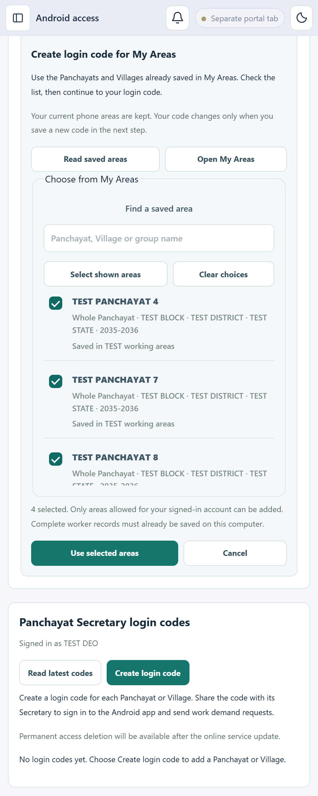
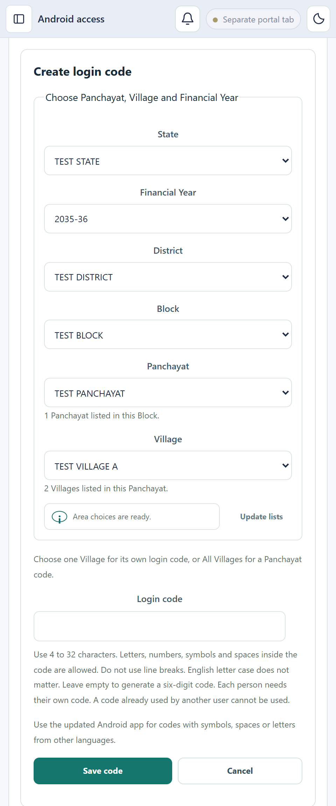
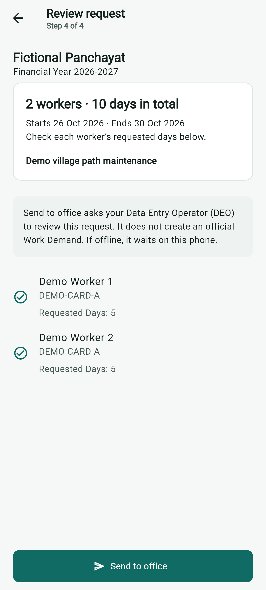
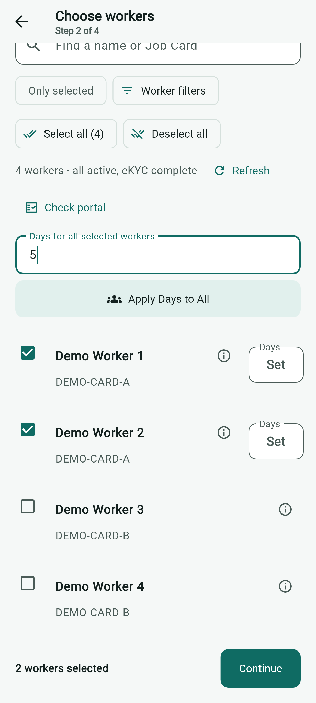
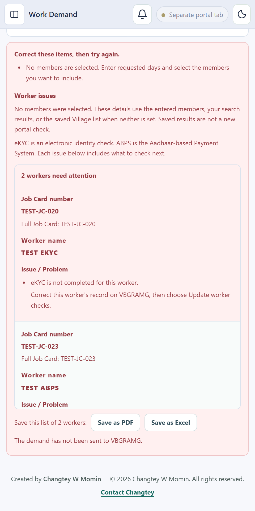
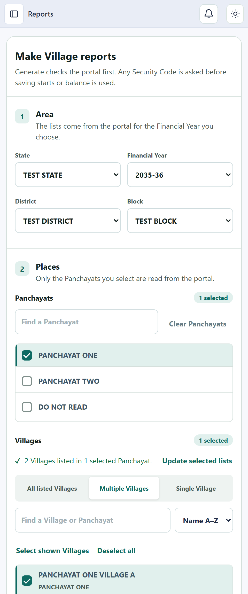

# User guide

[Home](../README.md) · [Feature list](FEATURES.md) · [Latest changes](LATEST_CHANGES.md)

**Screens captured for desktop 1.4.34 and Android 1.4.32 · 2026-11-05.**

Screenshots use fictional people and areas. Android and desktop are labelled separately. Your assigned areas and the portal's current lists determine what you can see.

## Watch and practise

The tutorial was refreshed on **3 November 2026**. Follow real app screens, slow spoken instructions and captions. All names, places and dates in the lesson are samples.

| Learn your way | Open |
| --- | --- |
| Tutorial: 9 short lessons, 6 minutes 21 seconds | [Watch the tutorial](https://changtey.github.io/Worker-Demand-releases/learn/classroom.html) |
| Guided practice with sample workers | [Try the practice app](https://changtey.github.io/Worker-Demand-releases/learn/practice.html) |
| Clear desktop and Android pictures | [Open full-size screenshots](https://changtey.github.io/Worker-Demand-releases/learn/screenshots.html) |
| Video file | [Open or download the tutorial](https://changtey.github.io/Worker-Demand-releases/videos/VBGRAMG-Tutorial-Simple-English.mp4) |

Watch a lesson, pause to read the screen, then try the steps. The practice copy ends at **Check demand**. It cannot send records to the office or the official work website.

The tutorial covers setup, area choices, Android requests, office review, days and dates, saved results, reports and settings. Read the result carefully: finishing entry steps is different from confirming that a demand was saved.

[Tutorial captions](https://changtey.github.io/Worker-Demand-releases/videos/VBGRAMG-Tutorial-Simple-English.srt) · [Written script](https://changtey.github.io/Worker-Demand-releases/videos/tutorial-transcript.txt) · [Lesson times](https://changtey.github.io/Worker-Demand-releases/videos/Tutorial-Simple-English-chapters.txt)

[Watch the earlier 60-second introduction](https://changtey.github.io/Worker-Demand-releases/#watch). Its 80–90% figure is the creator's estimate; actual results vary. The introduction uses CC0 public-domain music. The new tutorial has spoken instructions without music. The apps are free to download; some computer tasks use Balance. Read the current costs in the user guide.

## 1. Install and sign in

### First setup for your app account

Sign in to the app with your own Google account. This is separate from the official portal sign-in. Portal setup has only two steps:

1. **Select login area.** Choose your State, Financial Year, District and Block from the current portal lists. Choose **Save and open login page**. Use **Change login area** if you need another area.
2. **Sign in.** Enter your User ID, password and Security Code on the official VBGRAMG page. Choose **Login** yourself.

The app waits for the login form to be ready. Images that are still loading do not stop it. If the portal cannot open your choices, read the message below **Save and open login page**. Your area stays saved. Use the same button to try again. If a Security Code page is already open, finish it in **Sign in**.

After a confirmed sign-in, **Work Demand → Create demand** opens straight away. Choose the area and workers for the demand there. The first time, a short **Welcome tour** opens on top: six small screens about signing in, choosing your area, automatic downloads, making and checking a Work Demand, and Received requests. Use **Next** and **Back**, or the dots, to move. **Skip tour** or **Start using the app** closes it for good; **Open the full guide** shows the detailed 7-step guide. To see the tour again, open **Settings → Help** and choose **Take the welcome tour**, or choose **Welcome tour** inside **Quick guide**. Setup does not ask for work areas, download records or start Muster Roll report downloads. Older unfinished setup downloads do not block you.

After the tour, a new installation shows a small **Getting started** card with **Step N of 7**, one sentence about what to do next, and **Show me**. On a wide window it sits at the foot of the left menu. On a narrow window it sits in a bottom corner, and in **Browser** it sits above the portal page, never on top of it. **Show me** opens the right screen, dims the rest of the page and points at the button or box with a gold ring. The pointed place still works. Choose **Got it** or press Esc to close it. Each step ticks itself when the app sees the work done: the login area saved, a confirmed portal sign-in, a Panchayat and Village chosen, the Village's records ready, workers with their days, a successful **Check demand**, and a finished entry with its result. Choosing **Show me** never ticks a step. The minus button makes the card smaller. **Hide guide** hides it on this computer; open it again in **Settings → Help & tips → Show Getting started guide**. A computer that used the app before this card was added does not show it on its own.

**Save my User ID and password securely after a successful sign-in** is selected on the login-area form. Clear it if you do not want to save them. Only a confirmed sign-in saves the original pair in the computer's secure storage. A failed login keeps the earlier saved pair. The Security Code is never saved. Browser **Save login details**, **Update login details** and **Login details** remain available. Choose **Hide** to give the portal page more room, and the 🔑 button in the Browser toolbar to show the login bar again. The app remembers this choice on the PC.

All app menus stay available before portal sign-in and after portal sign-out. Opening a menu does not sign you in or submit records. Portal checks and entry still need the right signed-in account. Selected workers must pass the required checks before an official demand is sent.

### Records for your selected area

Choose the area you need in **Work Demand**. The app reuses saved records and reads missing records for that work. You can also use **My Areas** for places you work on often, or **Settings → Records** to download or update area records. These tools are separate from portal setup. **Reports** opens the Muster Roll tools when you need them. A Muster Roll is the official worker attendance list.

The current Panchayat or Village gets the first download and check. Completed records stay saved. A deliberate pause is kept. In Settings, **Download Data** reuses current saved records; **Update Data** asks for new checks. Read the progress message if a report stops. Personal sign-in and report Security Codes still need your answer.

Worker details and the four required checks come first. When Aadhaar Authentication, Aadhaar Seeding, ABPS and eKYC are all Yes, the app shows **Aadhaar Availability: Yes** so you can prepare Work Demand. It keeps the source of this answer. An actual No from the portal replaces that answer and blocks that worker. Download completion and permission to send a demand stay separate.

After all required members are read, **Aadhaar Availability download completed** gives separate counts for **Yes**, **No**, and **No answer selected on the portal**. No and unselected answers count as downloaded. Those workers need a confirmed Yes before Work Demand; other eligible workers can continue. An unread answer stays unknown. Reusing an answer keeps its original check date.

### Start the whole app again

Open **Settings → Factory reset** in the desktop app. This removes downloaded data, all settings, areas, filters, drafts, local request copies, local activity and entry history, recovery copies, saved passwords and sign-ins for every app account on this computer. Export anything you need first. The reset cannot be undone in the app.

Choose **Factory reset**, read the confirmation, tick **I understand that all local app data will be deleted**, then choose **Reset app and restart**. Cancel keeps your data. Work Demand entry or another active portal task must finish or stop before resetting. Report files must finish saving first. If another copy of the app has these records open, close that copy and its command window, then try again. This check happens before reset removes any records.

The app stops downloads, closes its local service, deletes the local stores and clears Browser sign-ins, then creates an empty record store and reopens at first setup. Sign in to the app again, choose your login area and sign in to the portal. Work Demand Creation opens next. Download area records when you need them. If reset is interrupted, reopening finishes it before normal startup. If a file cannot be removed, the app explains the problem instead of claiming a fresh start.

Your online account, online balance, online requests and official VBGRAMG records stay in place. Online records can appear again after you sign in. Files you exported outside the app stay in place. The saved storage drive stays the same. A shared/server database or a linked data folder needs help from the app manager; this button does not erase it. The web preview cannot reset the installed app.

Source-report downloads do not submit a Work Demand or generate a paid PDF copy. PDF saving and printing keep their existing separate confirmation and Balance rules.

If Job Cards, members, eKYC, ABPS, Aadhaar seeding and Aadhaar authentication are already saved and current, the selected area's missing Aadhaar Availability can be read directly from Work Demand. The app keeps those saved details. It skips confirmed Aadhaar Availability Yes answers and reads only the Job Cards that still need an answer. A complete selected Village also keeps its saved area list. Missing, changed or old records still get the reads they need.

### Update the Windows app

Choose **Update now** once. The app downloads and checks the file, then closes. A small installer window shows the update being installed, and the updated app opens by itself when it finishes. You do not need to click anything else, and you do not need to open the app yourself. Your settings, selected areas, downloaded records, drafts and securely saved login details are kept. A normal update does not repeat completed first setup or download everything again. Reports that need a daily update are checked as usual. If Windows asks for permission, read the request and allow your app's installer to continue. Do not turn off Windows protection.

If the download or installer cannot start, choose **Try again** in the same visit. The app reuses a downloaded file only after checking it again. **Open current app** remains available for an optional update. A required update must finish before the old app can be used.

**For older installed versions:** Install version 1.4.18 once to receive this improved updater. An older app still controls its own update steps until it is replaced. Linux and Android keep their normal device installation steps.

### Daily use

1. Open the [app downloads](https://github.com/Changtey/Worker-Demand-releases#download). Choose Windows, Linux or Android for your device.
2. Keep your existing app and saved records when updating. See the release notes for installation checks and known limits.
3. On desktop, use **Sign in with Google** and finish in your computer's usual browser. This is separate from your official portal login.
4. In **Settings → Portal login**, choose your State, Financial Year, District and Block from the current lists. Save the area.
5. Use **Show menu** on a narrow screen to open the app's menus. If an optional menu is hidden, show it in **Settings → Sidebar menus**.

The sidebar shows one line for each tool. Point at a tool to read a short explanation. Below 900 pixels wide, choose the menu button to open the menu as a drawer. **Work Demand** brings Received requests and manual entry together. Use its two source choices to switch without losing your current draft. **Android access** opens your own and Secretary access tools. Choose **Arrange menus** to show, hide or group menus. You can also drag menus into your preferred order. Every menu shows without scrolling. **Collapse menu**, beside the app name, keeps just the icons; **Expand menu** restores the names. Help and account links stay at the bottom, with **Sign out** beside your account name. On a short window the help links show as a row of icons; point at one to see its name.

Your selected Panchayat and Village stay in place while Received requests and background records are checked. Changing a Panchayat updates its Village choices. Use **Update lists** when you need to read an area list again. The earlier choices stay visible during that read and if it fails; choose **Try again** after a failure. Changing a parent area clears only the choices below it.

Published downloads: desktop **1.4.34**, Android **1.4.32**.

| Device | Download |
| --- | --- |
| Windows 64-bit | [Download 1.4.34](https://github.com/Changtey/Worker-Demand-releases/releases/download/v1.4.34/VBGRAMG-DEO-Assistant-1.4.34-Setup.exe) |
| Linux Debian / Ubuntu | [Download 1.4.34](https://github.com/Changtey/Worker-Demand-releases/releases/download/v1.4.34/VBGRAMG-DEO-Assistant-1.4.34-Linux-x64.deb) |
| Linux AppImage | [Download 1.4.34](https://github.com/Changtey/Worker-Demand-releases/releases/download/v1.4.34/VBGRAMG-DEO-Assistant-1.4.34-Linux-x64.AppImage) |
| Android APK | [Download 1.4.32](https://github.com/Changtey/Worker-Demand-releases/releases/download/v1.4.32/Worker-Demand-1.4.32.apk) |

[Release notes and checksums](https://github.com/Changtey/Worker-Demand-releases/releases/tag/v1.4.34).

### Find the next task

Open **Work Demand**. **Your work** shows unfinished Received requests from all days, including requests that need checking. It stays compact while you edit a request; choose **Show work overview** to open the list. The currently selected Village comes first, followed by its Panchayat. Choose **Open request** to review one. A finished request stays separate from an unfinished saved-result check.

Choose **Check problems** to open the app, saved-record, selected-area, portal sign-in and request-list checks. Follow **Open Browser** if sign-in is needed. These checks send no demand. **Review last entry** opens the last saved summary when members still need attention.

During a record download, the request list and open request show a bar and percentage. The percentage uses saved record checks. **Finding download totals** means the complete worker list is still being read. Paused downloads keep their saved progress. Sign-in problems and missing records remain visible. **100%** means the record checks finished; still choose **Check demand** before portal entry.

Downloads are automatic. When you choose a Panchayat or Village, only that area downloads. Other areas wait until it is complete. Job Card and worker details, eKYC, ABPS (Aadhaar Based Payment System), Aadhaar Seeding and Aadhaar Authentication download together. The four worker checks start as soon as the list of Job Cards and workers is saved, while the household pages are still downloading. Days worked and days left come next, then Work Codes, Work Orders and other reports. Aadhaar Availability on the Work Demand form is checked last, and the app shows how many workers it has checked. A worker whose four checks are all Yes counts as **Aadhaar Availability: Yes** for now, until the Work Demand form confirms the answer. If a read stops or fails, the app tries again on its own within two minutes and reuses completed records. If the Job Card page and the attendance report both open but show different work days, both are saved and the area still counts as downloaded. The download card says how many households to check. Reading again would not change them, so the app checks them again with its daily update. You do not need to click a download button. Private checks still need your own portal sign-in.

In the selected area's **Record updates**, each item shows its saved or checked count. Job Cards and workers have separate counts. Days worked shows how many active workers have usable saved days. Work Codes and reported Work Order numbers show separate saved counts for the selected Panchayat. Each identity or payment check shows how many active workers have a current answer, including a reported No. Earlier answers that need an update are shown separately. **Total still being checked** means the complete list is not known yet; saved counts remain visible.

**Required records come first.** The app first saves Job Card numbers or Registration IDs and household and member details from the complete registration and issued-card lists. Matching households appear in groups of up to 16 before their detail pages are requested. It then reads Aadhaar Authentication, Aadhaar Seeding, ABPS and eKYC together. The same worker report can fill missing Gender and Worker ID. Workers with all four Yes can begin Work Demand preparation while day figures and other reports continue. Actual Aadhaar Availability is checked last. Until the selected area's requested records finish, other Panchayats and Villages wait with their progress saved. Slow or failed extra reports do not hold up the basic worker list. Paused downloads remain paused.

Checked households appear as they are saved. The Village remains incomplete until every required page and household is accounted for. Closing a screen or retrying a download keeps completed saves. The active area's requested reports keep priority. Other extra reports start after 15 seconds without activity and pause at the next safe point when you resume work. A report needed for your current **Check demand** keeps its priority.

If a public worker list cannot be read, the app keeps the saved workers and follows its normal retry time. A failed public read is separate from waiting for private worker checks. Open **Record updates** to see what needs another read.

The Job Cards screen reads its list and totals together. Search covers all saved households before choosing a display page, including matching inactive workers and workers whose checks have not passed. Background updates keep the open households, search and page. **Eligible**, **Not eligible**, **Not yet checked** and **Data unavailable** describe the saved worker checks. Missing answers never mean eligible. Always run **Check demand** before portal entry.

Above the worker table, use **Show Worked** and **Show Days left** separately. Both are off until you turn them on. Your choices stay saved when the app reopens. The **Workers with no work this Financial Year** filter is information only and never leaves a worker out. These figures are information only, whether shown or hidden. Missing, old or unfinished day reports do not stop creating or checking a demand, reduce requested days or leave workers out. If both day values are missing, they stay **Not known**. Old figures show **Update needed** on a separate line below the saved number.

The app uses the **125-day Job Card total** to fill a missing value:

- **Days left = 125 − days worked.** For example, 76 worked means 49 left; 10 worked means 115 left.
- **Days worked = 125 − days left.** For example, 76 left means 49 worked.

These days are shared by the whole Job Card. If a member's own worked days are missing, the desktop shows the shared worked figure with **Job Card total** below it. A member's recorded worked days keep their own value. The Village total counts each Job Card once. A calculation keeps the saved check time and does not become a new portal check. Reported values and warnings about disagreeing reports are kept.

A current saved shared total avoids another request just for days left. If the required Aadhaar page already contains a checked day total, the app saves it during that same visit. A separate day check can still run when the available records need verification.

If the complete saved family list has a current worked value for every member, the app can add those values once and calculate the family's days left. One missing member value keeps that sum unknown. This does not give each member a separate 125 days.

The same rule applies to phone requests, Received request approval and **Send to VBGRAMG**. Missing, old, zero or small saved day totals cannot block these steps or reduce the days you entered. Checks for worker identity, required answers, valid dates and repeated or overlapping worker requests still apply. Any message from the official portal must still be resolved there.

In **Create demand**, the search, list size, **Add workers** and member buttons sit below **Optional day information**, directly above the worker list. Use **Add workers** to find saved members and add them to this demand. It remains available when the list is empty.

Use **Sort by** to arrange the whole saved list by name, Job Card number, active first or inactive first. Names and Job Card numbers can run in either order. Job Card groups stay together, and sorting happens before the list is divided into pages. Unknown status is kept separate from confirmed active and inactive status. Your sort choice is remembered. Sorting keeps your selected workers, entered days and dates, and checked demand.

Worker rows keep the last confirmed registration status when its daily check is old. **Saved: Active**, **Saved: Inactive** or **Saved: Deleted** appears with **Update needed**. Point to the status to see when it was checked. This saved label does not replace the current checks used for filters, sorting or demand entry. Records with no confirmed status still show **Active: unknown**.

Each worker has a clear status tag: **Active**, **Inactive** or **Deleted**. Deleted records stay saved and can be found by name or Job Card search. Search also shows matching records left out by your current filters, for review. Change the relevant Worker filter to **No filter** to keep them in the normal list. Required checks still decide whether a worker can be selected. This follows the selected area for any State, Panchayat or Village offered by the portal and the signed-in account; no example place limits the status labels.

Registration status is checked automatically when its daily update is due, while the app is running and downloads are enabled. Failed reads keep the previous saved status and follow the normal retry time. A successful background update changes the displayed tag without pressing **Refresh saved records**, keeping your entered days and dates. A deliberate download pause is respected. A portal or sign-in problem must be resolved before the missing records can finish updating.

Work Demand always checks the correct Job Card number and matching worker details, completed **eKYC**, active **ABPS**, and **Aadhaar Availability: Yes**. These checks cannot be turned off. If the Work Demand form has not confirmed Yes yet, all four matching, current worker checks can supply a temporary Yes for preparation. An actual No or an unanswered question on the form still blocks that worker. A later form answer replaces the temporary value. A confirmed form Yes keeps the existing eKYC and ABPS requirements. Photo and day figures remain optional information. **Ready to check a demand** and **all downloads complete** are separate results.

If Settings cannot read the worker requirements, it shows a message and **Try again**. Required checks stay required. Portal entry still needs a successful demand check.

Leave **Work Order or work** empty when no work is selected. An unfinished work list does not block that demand. A work you select still needs the matching Work Code, area, Financial Year and other existing work checks. The official portal keeps its own checks, and you still choose every official action.

### Protect saved records

Open **Settings → Records → Record backups**. The desktop app tries to make one checked copy each day while open. **Back up records** makes a copy now. **Check latest backup** recovers it into a separate test copy and checks it without replacing current records.

These copies contain this PC's saved Job Cards, workers, works and activity history. Phone requests, submission summaries, login details and government records are separate. Keep both backup files privately on another drive to protect against a lost PC. The app retains seven daily copies and five manual copies. Restoring the app's current records requires closing it and help from the person who manages it.

## 2. Create your personal Android access

On desktop, open **Android access**, then **My phone**.

The panel has two sections: **My login code** and **My areas**. Choose **View my areas** to read the saved list. Area choices and extra help stay closed until needed.

To replace an existing personal code, choose **Choose my own login code** near your current code. Enter **My new login code**, then choose **Save my login code**. Your selected areas stay the same. **Show code** lets you check what you typed. Cancel keeps your current code. The new box never creates a random code when left empty.

You can use a **4 to 16 digit number**, including one that starts with zero. Letters, numbers, symbols and spaces inside a code are allowed, up to 32 characters. Use at least 4 characters. English letters A and a work the same. Each person needs their own code. A code already used by another user cannot be used. If you choose one, the app says so and keeps your typed code so you can change it.

If your places are already saved in **My Areas**:

1. In **Android access → My phone → My areas**, choose **Create login code for My Areas**.
2. Review your saved Panchayats and Villages. Untick places you do not need. Search by place or group name; your other choices are kept.
3. Choose **Use selected areas**. Areas already added for the same Financial Year are reused. Current phone areas are kept.
4. Enter **My login code (optional)** and choose **Save my login code**, or leave it blank and choose **Generate my login code**.

Opening the shortcut does not add areas or change your code. A working code stays the same until you save a new code. Saving a new code ends earlier phone sign-ins. Secretary codes are kept separately.

If no areas are saved, choose **Open My Areas** and save your Panchayats or Villages first. Whole Districts and Blocks cannot be used in this shortcut. Areas need complete saved worker records and must be allowed for your signed-in account. Any problem is shown beside the affected areas. Confirmed areas are reused after a failed attempt. If My Areas changes during review, choose **Read saved areas** before continuing. An assigned area's Financial Year is kept; review that area before using a different year.

For other areas, **Add my Panchayat or Village** remains available. For Android access or changing areas manually:

1. Add your working Panchayats or Villages if they are not listed.
2. Choose **Set up my Android access**, or **Change my Android access** if already set up.
3. Search the assigned areas. Tick the areas you need. You can select several areas together; filtering keeps your choices.
4. Enter your preferred code in **My login code (optional)** in the code section, then choose **Save my login code**.
5. You can leave the box empty and choose **Generate my login code** instead. Saving a code ends earlier phone sign-ins and keeps desktop sign-in and Secretary codes.
6. Keep the code private. Enter it in the Worker Demand Android app. Choose from the areas assigned to your account.

Open **More code options**, then use **Disable my Android code** when access should end. Read the confirmation before removing area assignments; removing access does not erase official portal records.

To remove your own assignments, choose **Set up my Android access** or **Change my Android access**, select the areas and choose **Remove selected areas**. Check the listed names before choosing **Remove areas**. You can remove only areas assigned to your signed-in account. Other users' areas are protected. Saved worker records, requests, completed Work Demands, Muster Rolls, Secretary accounts, login codes and history are kept. The window stays open while waiting and shows any problem there. A confirmed removal stays removed even if the next list read fails. A lost connection can leave the result uncertain, so read the message before trying again.

## 3. Create Secretary access

1. In **Android access**, choose **Create login code**.
2. Choose the State, Financial Year, District, Block and Panchayat. Choose a Village for Village-only access, or keep the whole Panchayat choice when that is intended.
3. Enter a private **Login code** and choose **Save code**. Characters stay visible while you type. Current code rules are shown beside the field.
4. Share the code privately with the intended Panchayat Secretary.
5. The Secretary installs the Android app. In **Android access → Get the Android app**, the Secretary can scan the QR code with the phone camera, or you can choose **Copy link** and send the link. It opens the download page; choose **Download for Android**.
6. The Secretary signs in to the same Android app. Their account shows their assigned area and worker list.

Use **Read latest codes** to recheck a saved result after a connection problem. If a code is already used, choose another code. To end access, open its available disable or delete control and read the confirmation. Keep the Android app updated before using newer code formats.

Before saving access for a new area or Financial Year, download its complete worker list in **Settings → Download Data**. The code form checks for saved workers before sending the save. If records are missing, it explains what to download and keeps your entries for another try. After the download finishes, choose **Save code** again. Access is created only when you save. Saving access shares that worker list with the Secretary.

## 4. Use the desktop Browser

1. Open **Browser**, then open VBGRAMG with your chosen area.
2. Check the website and area before entering your User ID and Password.
3. Enter the **Security Code** yourself and choose **Login**.
4. On the matching official login page, **Save** or **Update** stores the login pair only when you choose it. **Login details** lets you change or delete the saved pair.
5. Keep the Browser open for current portal checks and entry. Follow the messages when the session needs signing in again.

Started entry, downloads and report reading keep going when you minimize the app, switch to another program or open another app tab. Keep the app open and the computer awake. Closing the app or letting the computer sleep stops the work; saved records are kept.

### Print, find and keyboard keys

**Print a page.** Choose **🖨 Print** in the Browser toolbar, or press **Ctrl+P**, to open the normal Windows print box for the page you see. The Work Allocation page keeps its own print window with every row (see section 8). While a portal task is running, Print waits until the task finishes.

**Find words on a page.** Choose **⌕** in the Browser toolbar, or press **Ctrl+F**. Type the words. **Enter** or **F3** goes to the next match, **Shift+Enter** or **Shift+F3** to the previous one, and **Esc** closes the find box. Printing and finding only read the page. They do not save, send or submit anything.

**Browser keys.** **Alt+←** goes back and **Alt+→** goes forward. **F5** or **Ctrl+R** reloads the page after asking you, because the portal may repeat its last request. **Ctrl+L** moves to the web address box. **Ctrl+** **+**, **Ctrl+−** and **Ctrl+0** change the page size as before.

**Other app screens.** **Ctrl+P** prints the open screen in light colours, without the side menu, and long lists print in full. In a window with its own **Print** button, such as the demand preview, **Ctrl+P** uses that button. **Ctrl+F** first moves to the screen's own search box when it has one; press **Ctrl+F** again to find words anywhere on the screen.

**Everywhere.** **Ctrl+C** copy, **Ctrl+X** cut, **Ctrl+V** paste, **Ctrl+A** select all, **Ctrl+Z** undo and **Ctrl+Y** redo work in the Browser page, text boxes, lists and settings, together with Tab, Shift+Tab, Enter, Esc, Delete, Backspace and the arrow keys. Right-click a text box or selected words for **Cut**, **Copy**, **Paste** and **Select all**. These keys are desktop app features; the web preview uses your web browser's own Print and Find.

The Browser is a desktop feature. The narrow preview shows its controls; it does not show a real official website or a logged-in session.

## 5. Find Job Cards and workers

1. Open **Job Cards**. Choose the Village and Financial Year.
2. Search by Job Card, member, household head or Village. Choose the Job Card status and saved check filters, then **Apply**.
3. Use **Show household members** beside a Job Card to see its workers and saved checks. Scroll the table sideways on a narrow screen for the other columns.
4. Use **Update from VBGRAMG** when records need updating. Keep an incomplete or unknown result open for review.

Job Card members share the household's days left. A missing total means **Not known**, not zero. The totals under the list count only the selected workers: **Job Cards selected**, **Members selected**, **Days requested**, and the shared **Days worked** and **Workdays left** of each selected Job Card (counted once). Every Job Card and worker has a serial number, which continues on the next page.

## 6. Make a work request on Android

The first time you sign in, a short **Welcome tour** (six screens) explains the worker list, choosing workers, checking them, **Send to office** and **History**. Use **Next** and **Back**. **Skip tour** or **Start using the app** closes it. To see it again, open **My account** and choose **Welcome tour**. It is in English and Hindi.

1. On **Home**, check the line at the top (it says whether records are connected and when they were checked) and your assigned Panchayat or Village. If requests are waiting for the office or drafts are saved on the phone, a short list appears; tap a line to open **History**. A DEO can choose among their assigned areas.
2. Choose **Create work request**. Search by worker or Job Card and choose the workers. **Select all** picks every worker shown now (after your search and filters), and **Deselect all** clears the choice. A worker who is active with eKYC complete shows no tag, and a line above the list says so. A worker who needs attention shows **Inactive**, **Status unknown**, **eKYC pending** or **eKYC unknown**. The same tags appear when entering days and reviewing the request. Open **Worker filters** and set **Active member** to **All** to include inactive workers. Missing or old answers show as unknown until checked again.
3. Choose **Check portal** to read the selected workers' public reports directly on the phone. Review eKYC and active status. Tap the information button beside a worker to open **Worker details** for days worked, family days left, Aadhaar availability, Aadhaar Based Payment System (ABPS), other offered checks, sources and check times. Choose **Stop portal check** if needed; your choices are kept.
4. Set each selected worker's requested days, or enter days in **Days for all selected workers** and press **Apply Days to All** beside it to use those days for every selected worker.
5. Continue to the work details. Enter the start date and the other requested details. Choose a saved work if needed.
6. Review the workers, days and dates, then choose **Send to office** to send it to the DEO.
7. Open **History** for the received status. **Being entered on VBGRAMG** means the office has started entry. **Entered – office is checking** means entry has finished and the office is confirming the saved result. **Completed on VBGRAMG** means the office has confirmed it. A draft is a saved phone copy. An offline request waits for a connection using its existing request number.
8. To send a request like an earlier one, open **History**, open the sent request and tap **Copy to new request**. The same workers, days and work are copied into a new request with a new request number. Choose a new **Start Date**, check the days, then send it. The earlier request is not changed.

**About direct phone checks:** The phone uses only public reports for the assigned area and selected Financial Year. It does not sign into an office portal or submit official records. A missing field keeps its earlier saved answer and check time. A failed, incomplete, very large or extra-page report keeps the saved office copy with a clear message. Sign-in or Security Code checks must be handled by a person; the phone reader cannot bypass them.

**Days worked and days left:** A worker's own days worked stay separate from the shared Job Card total. Days left belong to the whole Job Card family. The office calculates a missing shared value using the 125-day total and sends the saved family figures to the phone. Missing individual work stays unknown. The office still checks the records before official entry.

If access has ended, sign in again with a current code from the DEO. Some actions require a connection or a recent access check. A phone request is not an official portal Work Demand.

**Use the same days for several workers:** Select the workers, enter a number in **Days for all selected workers**, then press **Apply Days to All**. Check the Days box beside each name. You can still change one worker's days separately.

## 7. Prepare and check a demand on desktop

Open **Work Demand**. Choose **Create demand** for a new demand, or **Received requests** to read and open a received request. Both use the same worker checks and portal entry steps. Both lists group workers by Job Card, with **Sort by**, **Collapse all** / **Expand all**, **Refresh saved records**, page buttons and the selected Village's totals. The worker list grows with the page, without a second scroll bar. After **Check demand**, each worker in the problem list or the **left out** list has a **Remove** button, and **Remove all** takes them all out at once. A removed worker leaves this demand only; their saved records stay. Choose **Check demand** again afterwards. Switching source keeps your current edits during this visit. Android corrections and status updates stay linked to the phone request.

Follow **Area → Workers → Work → Days and dates → Review and send → Result**. Choose a step to return to it. This only opens that section; it does not save, send or repeat a demand. Your entered workers, dates and days stay on the page.

**Choose the Village and Financial Year** always stays expanded in Create demand. State, Financial Year, District, Block, Panchayat and Village stay visible while you move between steps. This panel has no collapse control.

A long place list, such as a Block's Panchayats, opens inside the page when you click it. Scroll it with the mouse wheel and click a place; Escape closes it without a change. Long place lists also have a **Type to find…** box under them. Type any part of a name, such as part of a Panchayat name. Up to six matching places show as buttons. Click one, or press Enter when only one is left. On Create demand, a place is chosen for you when it is the only one offered, for example a Panchayat with one Village. It never guesses between two or more. **Recent Villages** at the top brings back a Village you used before, with all its parent choices. The note under the lists says when they were saved, for example "Lists saved today at 9:12 am". These work the same in every State.

**Worker filters** also stays expanded. All filter choices remain visible, and clicking its heading does not hide them.

Each filter shows its confirmed matches and how many answers still need checking. **Leave out** removes confirmed matches only. Missing or old answers stay listed for review. A worker can match several filters and is counted once in **left out**. Changing one filter may leave the same worker out because another filter still applies.

**Work** is optional where the app already allows it. The bulk days box also selects eligible workers allowed by the current filters. Individual workers keep their own day and date controls in the worker list. Use **Edit individual days and dates** to return there.

In **Days and dates**, type a date or choose the calendar icon inside its box. The icon stays in place when you point to it. Application Date, Start Date and End Date each open their own calendar.

Use **Check demand** to find problems. Read the checked summary before **Send to VBGRAMG**. **Result** opens the active entry or your saved result list when one is available. A checked draft is separate from a confirmed saved portal demand.

Before sending, select workers and enter their days and dates, then choose **Print Demand**, the coloured button on the left above **Review and send**. It opens a draft preview with every selected worker across all list pages, each full Job Card and member number, their own dates, the Application Date, area, Financial Year and total requested days. Use **Save PDF** for a saved copy or **Print** to open your print window. Long lists continue on numbered A4 pages.

The preview and saved copy say **DRAFT - NOT SENT TO VBGRAMG**. Making a copy does not check, approve or submit the demand. **Check demand** and the existing portal checks still apply before sending. Closing the preview keeps your workers, days and dates. A changed area, account or demand closes the old preview, and a late PDF cannot replace the current work. This is a desktop feature, also available in the web preview; Android keeps its existing request reports.

Members and Work Order choices finish loading even while background updates continue. Earlier saved lists stay visible during a new read. Returning to this screen checks the latest saved lists. If the selected Village is still downloading, the app tries reading it again automatically. Your entered days and dates are kept. A download message is separate from the result of an official Work Demand submission.

For an Android request, its Panchayat or Village and Financial Year are prepared automatically as soon as the office receives it. You do not need to select its location or start a download. Recent complete records are reused, and requests for the same area share one download. Watch **Records** on the request for progress. You can keep working while it downloads.

Opening a received request gives its selected Village and Financial Year first priority for Aadhaar availability, ABPS and the other worker checks. You do not need to choose the same place in **Create demand**. This priority stays while you open **Browser** to sign in. Your separate Create demand area, days and dates are kept. For a request with several Villages, choose the Village you want to review.

The Panchayat or Village selected in the tab you are using owns the turn for its queued download or update, including areas outside My Areas. A selected Village holds downloads for its siblings and all other areas. A selected Panchayat includes every Village in its current offered list, read one by one. Other areas resume afterward, one at a time. This applies across Create demand, Received requests, Job Cards, Reports and area choices. Your saved My Areas stay the same. The signed-in portal account must still offer the selected area and Financial Year. Each open app copy shows the progress of its own portal connection.

When you change Panchayat or Village, the new choice gets the next turn, including a place you visited earlier. The previous page may finish; the previous area's remaining downloads wait with their saved progress. The next area starts after that read stops, without waiting for the regular background check. Required worker checks keep priority after the selected area's public lists finish. If the area lists briefly show **Switching to the selected area**, they continue automatically. You do not need to choose **Try again** for this handover. A deliberate pause or a removed download stays stopped.

If no records are arriving, read the message beside the progress bar. Deleted data needs **Download records again**. **Pause other areas** in Settings holds other areas only; the area you choose always downloads. Other missing records are tried again automatically. These messages do not say a download is running when it is stopped.

Temporary report interruptions try again after 2, 5 and 10 seconds. Completed Job Cards are kept, so the next read can continue with the unfinished cards. If the connection is still unavailable, the app saves another attempt for about one minute later and shows the next attempt time. Keep the app signed in. Changing area or pausing downloads stops these retries. If the portal sign-in expires, complete login yourself in Browser; saved records are kept. A changed or unclear report still needs checking.

After a new confirmed portal login, older incomplete required reads can continue without waiting for their earlier retry time. Completed Yes answers are kept. A new failed attempt keeps its own retry time so the app does not repeat it continuously.

After deleting an area's downloaded data, choose that area and **Download records again**, or use its **Download** row in **Manage Downloaded Data**. This starts a fresh download without waiting for an old failed attempt. Other stopped Villages stay stopped. Confirmed Aadhaar Availability Yes answers are reused while they remain saved; deleting the downloaded checks removes those local answers too.

If **Attention required** asks for a portal sign-in, open **Browser** in the desktop app and sign in personally with an account allowed to read that area and Financial Year. The remaining checks continue automatically when the portal is free. If you paused downloads, resume them in Settings. Wrong or unclear location details stay held for checking. **Ready** does not mean the workers are eligible or the demand has been submitted: use **Check demand** before the next portal action.

1. Check the area and Financial Year. Use current offered choices; do not replace an unavailable area with another place.
2. Check the **Application Date**. This is separate from the requested work dates.
3. Search the worker list or review **Worker filters**. Active status, Aadhaar availability, electronic identity verification (**eKYC**) and Aadhaar Based Payment System (**ABPS**) answers help find records to review.
4. Choose the workers. Set their own requested days, start and end dates. Days are shared by Job Card. Filters change what you see; review selected workers hidden by filters before continuing.
5. Use the available add or remove controls to change this demand's worker list. Removing someone from a demand does not delete their Job Card record.
6. Choose **Check demand**. Read the named worker and reason for every issue. Correct dates or selections, or update the saved checks, then check again.

In the pictured desktop workflow, a received request has two actions: **Check demand → Send to VBGRAMG**. There is no separate Approve button. Changes to workers or dates need a new check.

For an Android request, choose **Save Changes** to keep corrections without starting portal entry. Its reports use the saved request; save corrections before downloading the request's Excel or PDF.

## 8. Start portal entry and check the result

1. After a successful check, review the selected workers and totals.
2. Choose **Send to VBGRAMG** for either source. This starts desktop portal entry for the checked area.
3. New entries open **D.3 Work Demand → Demand**, then choose the requested Panchayat, Village and Job Card. The household is found by its full Registration ID (Job Card number); the worker is then found by name inside that household. When the next worker is in the same Panchayat and Village, the app picks the next Registration ID directly, as you would by hand, if the portal's copied dates land on that worker's own line with the same dates. If they land on another member's line, the app opens a fresh form and chooses the area again, so no dates stay under the wrong member. Members of the same Job Card are processed together. Households and their members are entered in the order that allows the direct choice most often; the list on screen keeps its order. Review every offered official action. The portal's **Proceed** can save an official demand; a separate final **Submit**, if offered, stays under your control.
4. Only after all new entries finish and the portal replies are confirmed, the app opens **D.4 Work Allocation → Allocation**. It chooses the requested Panchayat and, when offered, the Village. It then compares the full **Registration No.** (Job Card), **Job seeker name**, and the **Work Demand date → From / No of days / To** values. It reads every offered result page. The separate editable **Work Allocation Date** fields do not prove the saved demand. The list also shows demands entered by other people. A row the app cannot read clearly holds only the worker it may belong to; other workers are still checked.
5. Read the completion pop-up. It shows **Members processed**, **Entry steps finished**, **Saved demands confirmed** and **Failed entries**. Finished entry steps and confirmed saved demands are different counts. An unreadable final list can show 61 entry steps finished, 0 confirmed saved demands and 0 failures. The app keeps these entries and offers **Check saved results**, which sends no demand. Older saved summaries show the entry-step count only if it was recorded. Earlier saved demands, unverified results and unstarted members are counted separately. **Automation Completed Successfully** appears when every selected worker passes the final saved-list check, including if the browser stops after returning the complete matching results. A timing-report problem does not turn confirmed submissions into failures. If every entry went through but the saved list cannot be read, the app retries that read once. It then shows **Data entry finished for** the number of members, with a green tick and the label **Data entry completed**, and says how many still need the final check. Choose **Check saved results** to finish that check; it sends no demand. This is not a failed-entry count. Expand the member lists for each name, Registration ID and reason. Actual failed entries alongside confirmed demands show **Work Demand partly completed**. A filled form or a portal reply alone does not count as a saved demand.
6. Choose **Retry Failed Entries** to try only failed or unstarted entries. The app keeps earlier processed demands and holds uncertain entries. Choose **Check saved results** to read uncertain results without sending another demand. If the portal offers a separate final **Submit**, complete it yourself before checking again.
7. Close the pop-up with **Done**. Open **Work Demand → History** or **Notifications → View submission summary** to review it later. History keeps the last 100 runs on this PC for your signed-in app account, including after reopening the app. Choose **Open** to see a run's workers, days, dates and results. An older run records the result at that time; opening it does not start a new submission. If saving a run fails, the app tells you.
8. If the portal leaves entries pending for a separate final **Submit**, the app keeps that page open and waits for you to finish it. It does not open Allocation automatically while those entries are still pending. Then choose **Check saved list again**. For any other unfinished final check, use the same button. This reads the saved list without pressing Proceed again or changing Work Code, allocation dates or worker checkboxes. Application dates are compared only when the saved list shows them. When Allocation has no Village list, the app checks the requested workers by their full Job Cards under the selected Panchayat and explains this on screen.

### Use a worker list again

**History** keeps each processed worker list, so you can make the same demand again next week or later.

1. Open **Work Demand → History**. Each list shows its Panchayat and Village, the date, the number of workers and how many were saved.
2. Choose **Copy to new demand**. **Create demand** opens for the same Village with the same workers and requested days. The dates are left empty.
3. Add or remove workers, choose the new dates, then choose **Check demand** and **Send to VBGRAMG** as usual. Nothing is sent until you do this.
4. To continue a run that stopped halfway, choose **Copy unfinished workers**. Only workers whose entry failed or did not start in that run are copied. Workers still waiting for the saved-list check are not copied, because their demand may already be on VBGRAMG. Use **Check saved results** for them first.
5. To print a list, choose **Print**. The print window shows the area, Financial Year, each worker, their days and dates, and the result. It is a copy of what this PC recorded, not an official VBGRAMG document. **Print** is also in the result window that **Open** shows.
6. To remove a list you no longer need, choose **Delete**, then **Delete list**. This removes it from History on this PC only. It does not delete or change any demand on VBGRAMG or any received request, and the app still never enters the same worker twice for the same dates.

History shows lists from both **Create demand** and **Received requests**. Lists that came from a received request say **From a received request**. Runs saved before this update show results only and cannot be copied.

**Add workers from a list.** In **Create demand**, open **Add from a list**. Paste Job Card numbers, one on each line, or choose an Excel (.xlsx) or CSV file. A Job Card alone adds every worker on it. To add one worker, put their name after the Job Card, or their Member number in a column headed **Member**. In a pasted list without headings, `Job Card, 2` adds Member 2. Other number columns, such as serial numbers or days, never choose a worker. Job Cards not saved for this area are listed so you can check them. The list is read on this computer only.

**Process a received request again.** Open the request in **Work Demand → Received requests**. **Process again** shows how many times it was processed on this PC and when it was last processed. Choose **Copy workers to a new demand** to use its workers and days in Create demand. This works after **Completed**, **Partly completed** or a stop, as often as you need, until you delete the request. The request and its own history stay unchanged. The app still never enters the same worker twice for the same dates.

**Print the Work Allocation list.** When Browser shows **Work Allocation**, the **🖨 Print** button in the Browser toolbar is highlighted. Choose it, or press **Ctrl+P**. A print window opens with a preview of the actual pages: the area details and every row of the list, including rows below the screen, with the Registration No., worker name, family completed days, and the Work Demand and Work Allocation dates and days. Choose the **Printer**, **Paper size** (A4, A3, Letter or Legal), **Layout** and **Copies**, then **Print**. **Windows print options…** opens the normal Windows print box. Long lists continue on more pages, with the headings repeated and page numbers at the foot. Printing only reads the page. It does not press Save, allocate work or submit a demand. If the portal list has more pages of its own, the print says so; open each page on the portal and print it too.

If every selected worker already has an entry record on this PC for the requested dates, Send keeps the current portal page open and shows **Earlier entry records found**. It does not enter those demands again or immediately open Work Allocation. Choose **Check saved list again** to read their saved portal results. Work Allocation is used only to check saved demands; it is not the data entry page. A saved entry record on the PC is not final portal verification.

**Any number of workers.** The app has no worker limit. A Work Demand can include 100, 1,000, 10,000 or more workers. The portal itself lets only up to 100 people in a Panchayat wait for Work Allocation (the official step that gives them work and dates). Then it refuses new Work Demand with “You have registered 100 persons demand for work,Kindly allocate them first then do demand for the rest.”

The app enters the list in parts:

1. Before entry starts, the app reads how many people already wait in the selected Panchayat's **Work Allocation** list. This only reads; nothing is sent. The progress panel then tells you the split, for example: 298 workers will be entered in 3 parts: 100, 100 and 98.
2. At the end of each part, the app stops before the next worker, so the portal never has to refuse one. It checks that part's workers in the Work Allocation list while they are still listed.
3. The progress panel shows **Waiting for Allocation** and one short step, for example: “Part 1 of 3 done: 100 workers entered and confirmed. Allocate work to them on the portal, then press Continue.” Work Allocation for the Panchayat stays open in Browser.
4. Allocate work to those people on the portal yourself. You choose the work and dates. The app does not allocate work.
5. Press **Continue**. The app reads the waiting count again first. If the portal is still full, it stays stopped and asks you to allocate work. Otherwise it enters the next part of the same list and keeps every entry already made.

If the waiting count cannot be read, for example because Work Allocation shows only one Village, the app enters until the portal shows its notice. It presses OK, sends nothing more for that worker and stops in the same way.

If a part's workers cannot all be confirmed, the message says how many, for example “Part 1 of 3: 100 workers entered, but 4 could not be confirmed in the Work Allocation list yet.” Choose **Check saved list again** before you allocate work, because allocated workers leave that list.

Entry continues when you return to the request screen. Its message shows whether entry is running, paused, stopping or checking saved demands. Choose **Open entry progress** to return to Browser and use its entry controls. The request stays locked while entry is active.

The Browser progress panel shows one entry count, followed by **Remaining**, **Need your check** and **Failed entries**. **Waiting to start** and **Entering now** show the queue separately. The current member and Job Card appear below. **Saving not checked yet** means Proceed was used but the saved result still needs checking. **Pause entry**, **Resume entry** when paused, and **Stop after this worker** stay at the bottom while you scroll.

The app reduces repeated browser reads while entering a batch. It checks the current sign-in and waits for changing pages to finish. Before filling, it compares the live form with the form just checked. Before each Proceed, it checks the full Job Card, worker, area, dates and days again. A changed form stops entry and keeps your values. Saved entry records are checked together when starting, and each worker is protected separately before entry. These source improvements have been checked with fictional records; actual speed also depends on the portal and your connection.

Repeated checks also use the same private app connection to Browser. If a reply is lost, the app does not send that command again automatically. A possibly sent demand stays held for a saved-demand check. This improvement keeps the same worker checks and saved-detail visits.

Small area checks read the selected choices without copying the full Job Card list each time. Optional household days are read once during each form action and checked afresh next time. If the portal makes a field, choice or Proceed unavailable, entry stops before using it. Check the open form and wait for it to become available before trying again. Existing values are kept.

A ready form can continue even if a background picture has not finished loading. The app checks the current form and the portal's response, with a short limit on each browser check. A check that expires cannot press a button later. If the browser cannot continue, earlier entries stay protected and the normal safe retry message is shown. You do not need to use Pause and Resume to finish an unrelated picture load. Choosing **Pause entry** yourself still keeps entry paused until you choose **Resume entry**.

If a temporary browser or internet problem happens before filling starts, the app tries again up to three times, waiting 2, 5 and 10 seconds. Earlier entries stay in the same run. **Pause entry** and **Stop after this worker** also work during these waits. If the problem continues, check your internet connection, keep Browser open and sign in again if asked. Choose **Try again** for failed entries, or **Continue remaining entries** after a stop. These controls keep earlier results and only try failed or unstarted workers.

If the form was already filled, check its existing values before continuing. If Proceed may already have sent a demand, that worker stays held for checking in that run and is never sent again automatically. In a later run, VBGRAMG decides: for a worker this PC entered before on some of the chosen days, the app first reads the portal’s saved demands. It skips the worker if the portal shows a demand on the same or overlapping days, and enters the worker if not. An unclear reply follows this rule from 10 minutes after it, because a slow portal may still save it within that time. Use **Check uncertain entries** or **Check saved list again** to read saved demands. An unreadable saved list does not turn an earlier entry into a failed demand. A separate final **Submit**, when offered, stays under your control.

Open **Entry details** for the other counts, entry checks and time spent. Open **Worker results** for each worker's result, **Demand details** for the area, application date and requested dates, or **How entry works** for help. Problems and recovery actions appear without opening these sections. Confirmed saved demands and finished entry steps remain separate.

After an error or stop, open the request and choose **Send to Browser again**. The panel shows how many checked workers will reopen. It starts a new Browser run with the complete checked list for that Village and keeps the original workers, days and dates. Saved demands are skipped. Uncertain entries stay held for checking; use **Check saved list again** in Browser for those results. No saved result is erased. If the request or its workers changed, read the latest changes and check the demand again first. For several Villages, choose the Village to reopen; each keeps its own checked list. The button stays unavailable while another entry is active or Browser is opening. If opening fails, its reason appears beside the button.

**Edit and resend** is prepared for stopped requests and needs its online update before use. Once enabled, choose it to change workers, days and dates. Choose **Save Changes**, then **Check demand**, then **Send to VBGRAMG**. A new worker must belong to the same assigned Village. Earlier saved workers are shown separately and kept out of the next attempt. If an earlier result is unclear, use **Open entry progress** and **Check saved list again** first. Changes cannot be saved while entry is running. Cancel editing keeps the earlier request. A failed save keeps your edits on screen. Original received details and earlier results are kept.

## 9. Prepare Muster Roll reports

A **Muster Roll** is the official worker attendance list. Open **Reports** on desktop. **Make Village reports** has three steps:

1. **Area:** choose the State, Financial Year, District and Block from the portal's current lists.
2. **Places:** tick the Panchayats you need. Then choose **All listed Villages**, **Multiple Villages** or **Single Village**.
3. **Categories and pages:** tick the caste categories to include. Each page group starts a new page. Use **Change page groups** to join or rename groups.

The bar at the bottom shows the Villages selected, the balance needed (2 for each Village report) and your available balance. If something is still missing, the line under **Generate** says what to do next. Each Village gets its own PDF. Several Villages are saved together in one ZIP file. Only saved Village PDFs use balance.

**Generate** checks the portal first. If the portal asks for its **Security Code**, a box appears at the top of Reports before the save box opens and before any balance is used. You can also choose **Check portal now** earlier. Read the question, type the answer and press Enter. For a sum, the app shows a suggested answer, but you type and send it yourself. If the portal asks again during a long read, the same box appears, the taskbar button blinks and other screens show a reminder.

**Saved report copies** lists single Muster Rolls already read on this computer. Search by Muster Roll number, Panchayat or Work Code, then preview, print, or save them as PDF or Excel. **Read a public report page yourself** is for special cases.

Selecting areas or viewing the cost does not make a report. These are prepared copies of public portal reports, not official submissions.

## 10. Arrange settings and saved areas

- **Sidebar menus:** show, hide, group and arrange menus.
- **Appearance:** choose the available light, dark or system appearance.
- **Portal login:** save the portal area used to start work.
- **Records:** manage downloads and updates. The current Village or Panchayat gets priority, followed by other authorised areas.
- **My Areas:** keep commonly used places together.
- **Frequently used areas:** tick individual areas or choose **Select all**. Use **Clear selection** to untick them. Choose **Remove selected** or **Remove all**, review the names and confirm once. Saved records and My Areas choices are kept. Use **Show removed priorities → Use as a priority** to add an area again.
- **Manage downloaded data:** see saved data and queued areas together. Delete from any row, or select a status group and use **Delete Selected** or **Remove from Queue**. Confirm once.

Area choices, worker filters and list size are remembered. A new choice takes priority. If an old choice is no longer offered, review it instead of silently switching places.

Only one Village downloads at a time, including when you choose a whole Panchayat. The Panchayat or Village selected in your active tab gets the first turn for its queued download or update. Switching tabs or changing area changes the next read. Hidden screens and late replies cannot replace that choice. A page already loading may finish before the new area starts; completed records and unfinished progress are kept. If required worker records need sign-in or another attempt, the app explains the wait. Other queued areas continue one by one afterward. Recent complete records and recently read household pages are reused.

The area you open in **Browser** also gets first priority after the portal confirms its area. Changing the portal's area choices updates that priority without waiting for the next routine check. An update from a hidden Browser page cannot replace the area in the screen you are using.

For the active Panchayat or Village, data is read in this order:

1. Job Card numbers and Registration IDs.
2. Members and workers under those Job Cards.
3. eKYC, the electronic identity check.
4. ABPS, the Aadhaar Based Payment System status.
5. Aadhaar Availability.
6. Worked days.
7. Days left. A current saved day figure can provide the other figure using the shared 125-day Job Card total.
8. Other records, including Work Codes, Work Order numbers, Aadhaar seeding, Aadhaar authentication and additional reports.

You can choose workers when the essential worker records are saved. Day figures and other additional records continue afterward and do not change the days you entered. If one required page already contains several answers, all clear answers are kept without opening it again just to follow this list.

The app avoids finding the same area and full Job Card list again for every household. It reuses that work only while the account, area and saved records remain unchanged. Each worker is still matched on every page. On the last household page, new answers, any readable day figure and the household's download result save together. A failed save cannot leave a new completion result behind. Duplicate Job Card numbers, unclear worker matches and missing answers still need checking.

During new-area discovery, matching complete registration and issued-card lists let the required worker checks start before the remaining household detail pages. All basic worker groups must finish saving first. The final household checks still run, including later deletion notices. The Village stays unfinished until its full checks pass. Missing or conflicting records are never approved just because their names appeared early.

During one household save, the answer, day and completion checks share the household information just read. They still check the current workers, area and year. A small message after records save refreshes the visible counts sooner. It does not clear the selected Village, search or entered demand details. Missed updates are covered by the ordinary progress reads.

Switching area stops further reads for other areas and keeps their saved progress. Slow public Job Card requests also check for an area change while waiting. A page already returning may finish. The new area gets the next available turn; earlier downloads resume from their saved work afterward. A deliberate pause or removed download stays stopped until you choose to resume it.

Unfinished downloads for the selected area continue automatically. Choose **Recheck data** under the selected area's download progress to request fresh information for that Panchayat or Village and Financial Year. It keeps saved workers and entered demand details. The recheck button is also available after a download finishes. Sign in through the desktop app if private checks are needed.

The download panel returns when you reopen the app with a saved area. Job Card, worker, eKYC, ABPS and Aadhaar Availability counts appear directly under the progress bar. Counts update while the download runs. An unknown total stays unknown until the full list has been read.

Progress reads family members together to avoid repeated lookups. Shared day calculations still include all family members they need. Worker-check counts use the worker reader's matching rules. When a worker name, member number or Job Card number changes, an earlier answer can show **Update needed**. The earlier answer and its date stay saved. A reported No still counts as read; it does not mean that worker is eligible for Work Demand.

Deleting saved data or choosing **Remove from Queue** stops that area's download. Visiting the area keeps that choice. The panel shows **Download stopped** and explains the reason. Choose **Download records again** to restart only that Panchayat or Village for the selected Financial Year. Completed records are reused.

A confirmed **Aadhaar Availability: Yes** is kept for the same worker and Job Card. Later availability checks, including **Recheck data** and **Update Data**, skip that completed answer. No, missing, unknown, N/D and answers not yet confirmed as Yes are checked again when the area needs an update. Failed reads keep their waiting time. If one family member still needs an answer, the portal may require opening the whole Job Card page; the other members' completed Yes answers keep their original check time. Daily day-report reads also keep those Yes answers.

Job Card numbers, household and member details appear first, followed by Aadhaar Authentication, Aadhaar Seeding, ABPS and eKYC. Workers with all four Yes can prepare Work Demand. Days and other records follow, with actual Aadhaar Availability confirmation last. A slow household page does not hold back all the following cards; the existing limit of four public card requests is kept. Saved lists and their totals share the same short-lived display copy. The current checks used for demand review and official entry remain separate.

In **Settings → Records**, open **Download order · one area at a time**. Each area shows **Queued**, **Downloading**, **Paused**, **Completed** or **Failed**. Queued means it has not started its turn. Paused means progress is kept while another area has priority or downloading has been paused. Failed means a read needs another attempt; earlier saved records remain available.

The selected Panchayat or Village is also named beside its progress bar. Just below it, a compact download overview shows **Currently downloading**, **Paused** and **Queued**, with area names and the Financial Year. A Village includes its Panchayat name. Up to two names from each waiting list stay visible; choose **more** to see the rest. The display updates every few seconds without opening Settings.

The area records panel is small and steady. It shows the area name, a large download percentage, a progress bar and one short message. Below are small cards for each saved record: Job Cards and worker details, eKYC, ABPS, Aadhaar seeding, Aadhaar authentication, days worked and days left, Aadhaar Availability and Work Codes, each with its own percentage. eKYC, ABPS, Aadhaar seeding and Aadhaar authentication come from one portal report, so the app reads them together in one pass. Aadhaar Availability follows from them: a worker with all four Yes counts as Aadhaar Availability: Yes for now, and the Work Demand form check confirms it next. A status that flips for a moment while the app retries is not shown until it has lasted a few seconds, so the panel does not blink. Choose **Show more** to read a long message in full.

**Waiting to download** means the request is saved but no page for that area is being read yet. **Download paused** means you must choose to continue. **Download incomplete** keeps saved records and shows that more checks are needed. A saved request alone does not show a running download. When no page is being read, an unknown total stays unknown and the progress bar does not move. Read **Record updates** for report problems. A worker check can also explain that it is waiting for sign-in or for a portal form to finish.

When you switch areas, **Finishing current page** names the previous area if a page is still loading, and **Next** names your new selection. Its percentage stays separate from the selected area's progress. Once the new area's turn finishes, paused downloads resume automatically with their saved records. A deliberate pause or a removed download still needs your choice to restart. If totals are unknown, the panel says **Checking totals** instead of inventing a percentage. If its status cannot be refreshed, the panel labels the last reported download and tries again.

Opening **Browser** to sign in keeps the area from the screen you just used. In a list with several ticked Villages, the last ticked Village owns the download turn. While a named report area is being matched to the saved location list, downloads wait instead of reading another area. A tab with no selected area releases the area hold. A deliberate download pause stays paused.

The first records are matching Job Card and worker details plus all four worker checks. All four Yes allow a temporary Aadhaar Availability Yes for preparation while the form check waits its turn. Each selected worker must still pass the required checks. An actual No replaces the temporary answer and shows the reason. Day figures and work lists remain optional for Work Demand. Requested extra downloads keep their place in the selected area's queue. Being ready to check a demand does not mean every report is complete.

Work Codes and reported Work Order numbers follow worker and day reads, before the final Aadhaar Availability confirmation. Work Codes come from a public report that needs no login. If the selected area is still waiting for worker checks that need a VBGRAMG login, its Work Codes download anyway. Saved Work Codes appear in Work Demand while other reports continue. The app reads every offered work-report page before saving one shared Panchayat list. The list is reused across its Villages. Different works may have the same Work Order number; their Work Codes stay separate. A number not supplied by the portal stays unavailable. Choosing a work that needs a current check can request its work report sooner.

### Manage downloaded data

1. Open **Settings → Manage downloaded data**. Choose the State, Financial Year, District and Block. Use **Update lists** if the offered place list needs refreshing.
2. Read each area's **Status**, **Last updated** and **Size**. **Fully downloaded** needs saved completion checks for the chosen year; a Job Card count alone is not enough. **Size** shows saved Job Card and member counts for all years on this computer. **Date unavailable** means the saved copy has no usable date. **Queued**, **Downloading** and **Interrupted** appear beside the saved-data status.
3. Tick individual Panchayats or Villages, or choose **Select All – Fully Downloaded**, **Select All – Partial**, **Select All – Interrupted/Incomplete**, **Select All – Queued**, or **Select All**. Status selections cover matching areas throughout this Block, even when search hides some names. Villages with other statuses stay unticked. You can still tick or untick any Village afterward. **Clear selection** starts again. Areas with neither saved data nor a queued download are left out of these group selections.
4. For one area, choose **Delete** on its row. For several, choose **Delete Selected**. Review the names and record counts in one confirmation, then choose **Delete Selected**. This removes downloaded Job Cards, members, checks and day records for **all Financial Years**. Matching downloaded work details and report copies are included. A private recovery copy is checked first. **Cancel** keeps the data. You do not need to read a missing Village list first.
5. To stop waiting downloads while keeping saved records, choose **Remove from Queue** on a row, or select several areas and use **Remove from Queue** above the list. Only selected areas still in the queue are included. Check the names and confirm once. A page already being read can finish. Removed areas stay stopped after reopening the app until you choose **Download selected** or **Recheck selected** again. Restarting one Village keeps its stopped siblings out of the queue.

Confirming **Delete Selected** pauses all downloads automatically. The app stops new pages and waits for the current page to return before checking the private recovery copy and deleting. Downloads stay paused afterward, including after reopening the app. Use **Download** or **Recheck** when you want to start again. Deleted areas stay stopped until you choose them again. If a page takes too long to stop, records are kept and the same confirmation offers another try.

Official submissions, demand history, phone requests, login details, area choices and exported files are kept. A running Work Demand entry or another official portal task must still finish or be stopped before deletion.

For a single area, choose **Download** directly on its row to continue missing records, or **Recheck** for fresh information for that Panchayat or Village and the chosen Financial Year. Saved records and confirmed Aadhaar Availability Yes answers are kept. A stopped area starts again; other stopped Villages stay stopped. You do not need to tick the row first. For several areas, use **Download selected** or **Recheck selected**. A whole Panchayat can be downloaded before its Village list is read. **Read Village list** is needed only to choose individual Villages that are not already listed. Downloads proceed one Village at a time while you use other app screens.

Saved records are shared across the app. Opening another tab, changing a filter or choosing another Village in a Panchayat reuses the information already saved for that area and year. A complete saved work list also survives reopening the app. Another download is needed only for missing, incomplete or outdated information, or when you ask for an update. Different report types still need their own report data.

Unrelated background updates do not cancel the deletion confirmation. If the selected records change while it is open, the same confirmation reads the latest counts and tells you to check them. Nothing is deleted until you confirm those updated details.

Removed areas stay stopped across restarts until you choose to download them again. A recheck keeps confirmed Aadhaar Availability Yes answers. Deleting an area's downloaded checks removes those local answers too; a fresh download must read them again. A family with manually saved members needs review before its downloaded Job Card can be deleted.

## 11. Balance and Recharge

Open **Balance & recharges** from the side menu. **Balance** is the app credit used for charged tasks. Recharge prices are shown in rupees. You can see your available balance, paid balance, free balance and any balance held for unfinished tasks.

A low balance never stops a Work Demand task. Village reports show a **Recharge** button when the selected reports need more balance. A low-balance answer while starting or saving a report also opens Recharge. Your current request and report choices are kept.

1. Read the balance and recharge price.
2. Choose an amount: ₹50, ₹100, ₹150, ₹200, ₹250, ₹300, ₹400, ₹500 or ₹1,000. Or type any whole-rupee amount from ₹50 to ₹1,000 in **Other amount**. No amount is chosen until you choose one. Each ₹1 you pay adds exactly 1 Balance, so ₹150 adds 150 and ₹1,000 adds 1,000. Choose **Recharge** and confirm before opening Razorpay. The Razorpay page always asks for the amount you chose. If the payment service does not confirm that amount, the app does not open Razorpay and no money is taken.
3. In the desktop app, Razorpay opens in a payment window inside the app. The window title shows which site is open, such as your bank's page. Complete the payment yourself, then close the window. The app checks the payment at once, and closes the window by itself when Razorpay reports the payment first. The app adds balance only after the payment has been checked. The message names the amount paid and the Balance added, for example "Payment of ₹150.00 checked. 150 was added to your balance once." If you close the window without paying, choose **Reopen this recharge** to pay later. **Check payment** in the list still works at any time.
4. Choose **Return to your work**. Review the kept details, check the balance and choose the next task action yourself.

If an earlier recharge is not finished, the app offers **Reopen this recharge** at its first amount. Choose **Choose another amount** to start a new one instead. The earlier recharge stays in the list, and **Check payment** still works for it.

A successful Work Demand entry uses 1 from your Balance for every 20 selected workers. A part of 20 counts as a full 20:

| Selected workers | Balance used |
| --- | --- |
| 1–20 | 1 |
| 21–40 | 2 |
| 81–100 | 5 |
| 101–120 | 6 |
| 281–300 | 15 |

Before entry starts, the app sets this amount aside from your available Balance. It is used only after every saved Work Demand is confirmed. The entry progress panel shows the amount set aside and, at the end, the amount used. A failed run releases its reservation. A run with an unclear result keeps its reservation until its saved result is checked. A funded run can continue using that reservation; it does not pay twice. If a run stops part-way and is not continued, you pay only for the workers whose demand was saved and checked: 1 for every 20 of them, never more than the amount set aside. The rest is released. This happens when you start another Work Demand task, or when nobody has continued the run for a day. If you later continue the same list, workers already paid for are not charged again. A run that set aside Balance at an older price keeps that price.

Each time Balance is used for Work Demand, the bell in the top bar shows a **Balance used for Work Demand** notice. It says how much was used, for how many saved and checked workers, in which area, any part owed and the Balance left. A new notice also appears as a Windows notification, so you see it while the app is in the background. Choose **Mark as read** to remove it. The same charge is also listed in your balance history.

If the available Balance is too low, entry still starts and runs normally. There is no message and no stop. The app sets aside what is available and records the rest as owed. For example, 298 workers use 15; with 5 available, 5 is set aside and 10 is owed. The progress panel shows both parts. If the run fails, nothing is used and nothing is owed. If every demand is saved and confirmed, the owed part becomes an **Amount owed** on **Balance & recharges**. Your next recharge, or any other Balance added later, pays the amount owed first, automatically. The rest is added to your Balance. Your balance history shows this as **Amount owed – taken from new balance**. An older copy of the app must be updated before it can start a new charged run. Completed free work keeps its original price. If the balance cannot be checked, entry waits until it can be checked.

A successfully saved Village report uses 2, including each Village in a whole Panchayat. Failed reports and cancelled saves cost nothing. Viewing a cost or opening Recharge does not start a payment.

## When something needs attention

| Message or result | What to do |
| --- | --- |
| Area or Financial Year unavailable | Read the current lists and choose an offered value. Check that the portal account has access. |
| Saved records incomplete | Keep the saved records, update the selected area and read the result again. |
| Worker check unknown or old | Update the checks. Unknown does not mean Yes, No or zero. |
| Aadhaar available not confirmed Yes | Review that worker's portal answer before portal entry. Do not use a filter to bypass the check. |
| Request changed elsewhere | Read the latest changes, review the workers and check again. |
| Portal reply uncertain | Check the saved list before retrying. |
| Saved records changed. Check the demand again. | The notice lists each worker in this demand whose saved record changed, and how. Choose **Check demand again**. Your workers, days and dates are kept. A change to another worker in the Village does not clear your checked demand. |
| Need your check (during entry) | Choose **See why … workers need your check**. Each worker shows the earlier entry that holds it, its dates and what to do. A held worker is never sent twice. |
| Saving a list of workers with issues | Choose **Save as PDF** or **Save as Excel** below a worker issue list. The file is a list to check or print. It is not an official record and sends nothing to VBGRAMG. |
| Balance too low | Open Recharge, check the amount and decide whether to add balance. Your current work is kept. |
| Phone offline | Keep the same saved request and reconnect. Check History for its received status. |

### Ask for help

Open **Help & contact** at the bottom of the menu. **Join WhatsApp group** opens the app's WhatsApp group, where you can ask questions. If WhatsApp on the computer does not open or stays blank, scan the QR code in **Join from your phone** with the phone camera or WhatsApp, then tap **Join group**. **Email me** opens your email app. Never share passwords, Security Codes or Aadhaar numbers in the group.

Never include real Aadhaar numbers, passwords, Security Codes or login codes in a screenshot or public issue. Explain what happened using fictional examples.

## Simple navigation and settings

The desktop menu uses **Work Demand**, **Job Cards**, **Reports**, **Browser**, **My Areas**, **Android access** and **Settings**. Your saved menu order and hidden choices are kept. **Reports** opens Muster Roll Reports, the official worker attendance lists.

**Settings** groups choices under **Work**, **App** and **Account**. On a narrow screen, use **Settings section** to choose a page. Unsaved changes stay while you switch sections. Read any unsaved-change warning before closing the app.

In **Android access**, use **My phone**, **Secretary codes** or **Get the Android app** to go to the matching section. Existing codes and area safeguards still apply. **Job Cards** puts search before totals; open **More totals** or **About this list** for the other information.

The Android request pages show their current step: **Area → Workers → Work and dates → Review**. **Send to office** sends a request to your Data Entry Operator (DEO). The office still checks it before official portal entry. The send button stays below the review list while you scroll. Phone drafts and waiting offline requests are kept.

---

## 12. Choose your language

Both apps can show English, Hindi and Garo.

- **Android:** choose **Language** on the sign-in screen or in **My account**. The choice is kept on the phone. Sign-in, Home, Choose workers, Request details, Review and History have Hindi text.
- **Desktop:** choose **Language** at the top of **Settings → Appearance**. The menu, top bar, footer and the Work Demand page have Hindi text. Other desktop screens are still being added and show English.

Hindi is a first draft. **Garo is a draft translation**: it has no words yet, so the app shows English and says so until a Garo speaker has confirmed the text. Names, numbers, dates, amounts and official names such as Job Card, Work Order and Muster Roll are not translated.
